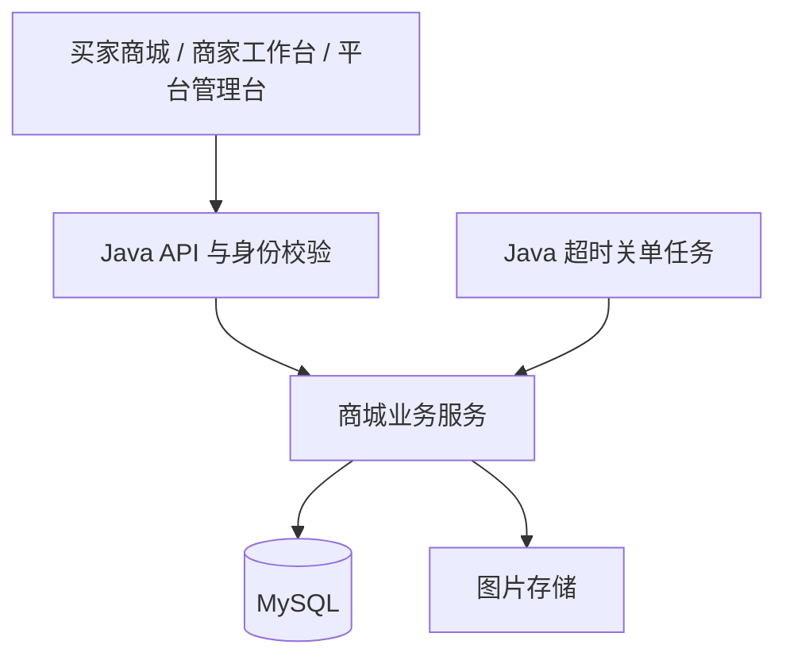

# 拾集 · 技术与 Agent 方案 v0.3

更新日期：2026-10-23  
状态：D072 优先复用 Mac 现有数据库、工具与缓存镜像；前端延期，当前仅环境连接准备。首版 Java / Spring、后续 Python 不变，正式工程未创建，Agent 继续暂缓。

## 1. 已确定的开发顺序

D072 当前仅准备已有环境与独立项目库连接，前端暂停；不因延期自动开始完整 Java 实现。此前 D071 的前端先行属于历史顺序，后续启动由用户另行安排。详见 [本地开发环境](17-本地开发环境.md)。

用户已决定先使用 Java / Spring 完成商城，之后再迁移到 Python。首版默认采用 Spring Boot，按业务模块组织一个商城后端；FastAPI 保留为后续 Python 版本的候选框架。

| 阶段 | 商城后端 | 主要交付 |
| --- | --- | --- |
| 第一阶段 | Java / Spring Boot | 商城交易闭环、角色权限、查询 API 契约及按需接入中间件 |
| 第二阶段 | Python，候选 FastAPI | 对照既有接口、数据模型与验收场景实现 Python 版本 |

迁移准备优先体现在接口、规则和数据的清楚定义上。首版不同时实现两套商城后端，也不因未来迁移提前拆成微服务。Spring Boot 提供独立运行的 Spring 应用基础能力。[官方说明](https://docs.spring.io/spring-boot/)

## 2. Java 首版的组成

| 层 | 候选技术 | 用途 |
| --- | --- | --- |
| 前端 | React + TypeScript + Vite（D073 已确认） | 商城、商家工作台、平台管理台；D074 已指定 shiji 目录，工程尚未创建；导购交互暂不开发 |
| 路由与数据 | 前端路由与请求缓存层 | 页面导航、服务端数据状态；具体依赖接入时选择 |
| Web 后端 | Spring Boot + Spring MVC + Bean Validation | API、输入输出约束与业务入口 |
| 认证授权 | Spring Security；会话或 JWT 方案待定 | 登录身份、接口访问控制与店铺权限 |
| 数据访问 | JDBC / MyBatis / JPA 中择一 | 工程接入后结合已有代码确定，不同时堆入多套 |
| 数据库迁移 | Flyway 或 Liquibase 中择一 | 首版由 Java 工程统一管理 schema |
| 数据库 | D072 复用本机 MySQL；项目库与物理设计待实现 | 用户、商品、库存、订单与支付；当前不创建 Agent 记录表 |
| 图片 | 本地文件存储接口 | 演示用图片；部署后可替换为对象存储 |
| Agent（后续候选） | 以后启用时再评估 Python 独立服务 | 当前不创建；先定义可复用的商城查询 API 与权限边界 |
| 开发与交付 | Mac 本地现有环境，缓存 Compose 工具按需使用 | 按服务启动、调试与重建，开发和演示分别配置 |

Vite 提供 React / TypeScript 模板与前端开发构建能力。[官方入门](https://vite.dev/guide/)
Spring Boot 支持 Flyway、Liquibase 等迁移工具；项目仅选择一套有效 schema 管理链路。[数据库初始化说明](https://docs.spring.io/spring-boot/how-to/data-initialization.html)

D072 复用现有 Redis，具体业务用途按模块决定；首版不预设消息队列、Elasticsearch、向量数据库或微服务平台。关键词与结构化筛选先由数据库承担；规则文档检索有明确需求时再加。
用户提到的 OSS、消息队列和令牌能力均可作为工程练习项。消息队列候选 RabbitMQ + Spring AMQP；是否纳入首版及接入时机在工程接入后确定。[Spring AMQP](https://docs.spring.io/spring-amqp/reference/)
Java / JDK、Spring Boot 及前端和数据库的具体版本在工程接入后核对兼容性并锁定。模型供应商、Python Agent 版本与 SDK 待用户后续启用 Agent 时再选，不加入当前依赖。

D070 本地协作继续保留；D072 撤下 D071 的独立数据库和前端预览容器配置，Compose 仅保留已缓存工具并禁止自动下载。本机已有 MySQL / Redis 直接复用，项目专用账号/空库仍未验证；前端暂停。详见 [本地开发环境](17-本地开发环境.md) 与 [容器说明](10-Docker容器开发.md)。

## 3. 架构与模块



业务后端采用模块化单体：`auth`、`merchants`、`catalog`、`cart`、`orders`、`payments`、`admin`。Controller 负责请求响应；金额、库存、状态转换和资源权限位于 Service，数据访问位于 Repository 或 Mapper。查询接口复用 `catalog` 等商城模块，当前不创建 `agentgateway` 或空的 Agent 服务。

商城接口主要维护 [OpenAPI 草案](openapi.json)，79 项接口按模块开发时细化，[导入说明与旧稿](16-接口文档.md) 保留参考（D063）。D062 四项业务规则保留；认证及物理实现仍待定，没有可调用服务。面向以后 Agent 只预留 [公开查询边界](11-Agent接口预留.md)，当前不开放 Agent 写入能力。

D062 对技术实现的约束：启用组合唯一须由数据库约束及事务协同保证，不能使用全历史组合唯一键阻止新 ID 再售；素材绑定与回收须协调并可恢复删除失败，不强制 ref_count 或额外队列/服务；数量目标合并在前端按 item_id 执行，服务端仍保留幂等和冲突校验；401 内存保留不替代认证/授权，也不决定 Cookie/JWT/refresh 方案。本轮仅文档，无服务/任务运行。

用户后续启用 Agent 后，再评估浏览器经 Java 入口转发流式事件、Python 通过受限 API 查询商城的方案。届时调用上下文由服务端生成并重复校验权限，不接受模型自行声明身份，也不让 Agent 直接写商城业务表。运行记录的归属和存储在该阶段再设计。未来商城迁移为 Python 时，查询契约可继续复用。

超时关单先采用 Java 定时任务或同代码库的独立任务进程扫描数据库，到期状态由数据库持久保存，进程重启后继续处理。单实例演示仅启动一个扫描器；多实例时增加任务协调与数据库领取机制，处理本身保持幂等。

当前只实施商城职责，内部继续保持单体。消息队列消费者如有需要独立运行，不因此拆分订单、库存和支付。

## 4. 核心数据模型

候选表、核心字段及待选约束见 [数据库结构复核](14-数据库结构复核.md)。P033 的角色关联、商品八张基础表及人工库存调整记录仍待确认；D061 已采纳 P034 的购物车简化方案，仅 cart_items 直接按 user_id 归属，零行表示空购物车，不建主表、不在注册时初始化。详细字段类型/索引仍待选择，未生成 DDL 或迁移。

P036 已将最终评审版本汇总为 5 个模块、28 张候选业务表，见复核稿第 10 节；未将最后复核请求视为已采纳全部拆表。该清单用于收敛单一商城数据模型，数据库产品、具体类型/索引与认证会话机制仍待选择，不将表数等同于服务数或已部署组件数。

逐表字段与主外键建议见 [P037 字段与关联字典](15-数据库字段与关联字典.md)。购物车项、地址等通过自己的 `user_id` 引用账号；店铺通过成员关系取得，店铺订单的买家通过支付单取得。ORM 对象可映射关联集合，不将其等同于 users 内的购物车/订单 ID 数组。多目标通知、平台操作与幂等结果采用受控逻辑引用，不能伪称一个 ID 是指向多张表的 SQL 外键；后端仍逐次检查目标权限。

P034 查询建议仍待确认：详情按关系批量读取并组装，避免独立多行集合膨胀及逐 SKU 查询，不按表数禁止 JOIN 或强制 Redis。最终价格过滤/排序必须在最终分页前完成；自填展示价分支的具体口径由 P035 继续讨论。系统自动起价摘要若缓存须覆盖库存占用/释放等可售资格变化，自填展示值另保存并触发相应失效；未运行数据库或验证性能。

用户已按 D050 确认先讨论数据库，并按 D051 确认首版一个账号最多拥有一家店、保留成员结构用于扩展；[数据库设计讨论稿](13-数据库设计.md) 已整理关系图、候选表与约束。D052 确认管理入口复用登录、后端检查角色的行为；管理员角色表字段仍待讨论。商品/SKU/库存拆分进一步展开为 P028 的规格维度、选项及组合关联候选，详细物理结构尚未冻结，也未创建唯一约束或其他数据库对象。

D053 已确认商品归店铺、SKU 归商品、实际售价库存按 SKU 管理、购物车项和订单明细引用 SKU，以及默认 SKU、整数分和成交快照；P028 的物理拆分未整体采纳。D061 确认购物车仅 cart_items.user_id，注册无需购物车记录，表结构由迁移统一建立。

D060 更新 D054：列表主图仍为商家指定的排序首图；可空的商家展示价填写时优先，未填/清空时采用有货优先的 SKU 最低价，全售罄仍返回参考状态并禁购。候选 products.display_price_override 保存填写原值；display_price/source 表达最终展示值及来源，min_price/max_price 保持真实 SKU 范围，不相互覆盖。展示价不作结算依据，SKU 价格和库存仍须核验；标签、差价校验、过滤排序细节见 P035 待确认。仅更新 [契约草案](11-Agent接口预留.md)，未实现或验收查询服务。

D055 确认草稿保存与重新加载应由服务端持久化支撑，按同一商品 ID、店铺权限回显已有内容并继续更新；字段可空范围与发布校验分开设计。SKU 可选关联本商品的一张图片并回退主图，具体关联字段待定。库存人工调整与记录保持一致，记录前后数量/原因/操作者/时间，并识别旧编辑数据冲突；版本条件或差量方案及记录表物理结构仍待选择。`published_at` 只在首次成功发布设置，上新排序不因编辑或重新上架重置。

D057 已确认规格替换保存方案：一次保存停用并保留旧 SKU、为新组合建立新 SKU，保留旧组合含义及历史引用；旧购物车不改绑新 SKU。库存为零显示已售罄，替换失效则显示“所选商品不能购买”、商品图变灰且禁结算，图片/标题导航到原店铺。原店铺 ID 由可信归属取得，导航仍受店铺可见性校验；灰图不等于禁用链接。公开 SKU 停用项仍为 `NOT_AVAILABLE`，完整购物车私有契约及物理字段继续设计。详情默认规格未定，本轮未实现持久化或修改原型。

D058 新增商家自主下架状态页：原商品曾公开且店铺正常、无平台限制时返回最小下架状态，其他不可见场景仍按统一不可见响应；购物车显示商品已下架并进入该状态页，下方推荐其他商品。下架不清零库存、不删除记录，不改变已有待付款及历史订单规则。

D059 已采纳 P032：在商城模块复用资格校验、D060 展示价及 D054 实际 SKU 范围与公开 DTO 做规则候选，首页混合新品/人工精选/分类并适当打散店铺，相近候选少量稳定轮换；下架页优先本店同类近价、在售有货商品，不足再全站补齐，仍不足则少展示。翻页和详情返回保持顺序，用户明确排序不被混排覆盖；稳定结果集/种子、数量、近价阈值及缓存随工程设计细化。现有商品字段支撑首版，不新增行为/喜好表或独立推荐服务。喜好推荐留待有行为数据后，采集范围、窗口、权重及记录结构另议，当前不开发 Agent，见 [数据库讨论 3.8](13-数据库设计.md)。本轮未实现推荐查询或调整 Demo。

| 领域 | 关键实体 | 核心约束 |
| --- | --- | --- |
| 身份 | User、Role、UserRole、Session | 密码仅保存哈希；管理员角色不能由普通注册获得 |
| 商家 | MerchantApplication、Store、StoreMember | 店铺成员关系限定资源访问 |
| 商品 | Category、Product、SKU、ProductImage | Product 为 SPU；SKU 有独立价格和库存 |
| 购物 | CartItem、Address | 同一用户同一 SKU 合并数量；地址必须属于本人 |
| 交易 | PaymentGroup、ShopOrder、OrderItem | 一次结算关联多个店铺订单；订单明细保留成交快照 |
| 库存 | InventoryReservation | 每条订单明细最多一个占用记录；记录占用、确认或释放状态 |
| 支付 | PaymentEvent、IdempotencyRecord | 事件唯一；同一用户同一幂等键不得产生重复结算 |

后续启用 Agent 时再评估 Conversation、Run、ToolCall 等实体；当前不建表、不生成迁移，也不增加对话或运行记录接口。

金额使用整数分，时间以 UTC 存储、按用户时区显示；订单使用服务端时间判断是否过期。
历史订单不依赖商品当前标题或地址表当前值。商品停用采用状态字段，保留历史引用。

同一 User 同时承担购物与店铺经营身份；商家中心根据申请与店铺状态返回对应页面数据。正式申请至少区分草稿、待审核、通过、驳回，并保存提交时间、审核人、审核时间和驳回原因。审核通过、创建店铺与绑定店铺成员关系需保持一致；前端切换场景不授予商家或管理员权限。

右侧工具栏收起状态属于 UI 偏好，不改变服务端权限。购物车、消息和反馈面板分别读取各自接口，页面不能把本地角标当作服务端数据来源。

## 5. 交易一致性

### 下单事务

客户端提交选中的 SKU、数量、地址、预览标识和幂等键。服务端校验资源归属与价格，按店铺分组，在一个事务中完成库存占用、支付单、店铺订单和快照创建；任何一个 SKU 失败，整个事务回滚。

建议库存字段采用 `available_stock` 与 `reserved_stock`：

- 占用：可售库存减去数量，占用库存增加相同数量。
- 支付：占用库存减少，记录已确认；不再扣一次可售库存。
- 关闭：占用库存减少，可售库存恢复，记录已释放。

占用采用带库存条件的原子更新或行锁；不能先查到库存后无条件扣减。商家编辑可售库存采用相同并发控制，不得覆盖占用数量。多个 SKU 按固定顺序处理，降低死锁概率。数据库增加非负约束，占用记录增加唯一约束。
此前 PostgreSQL 行锁资料仅作历史比较；D072 当前复用本机 MySQL。具体行锁、唯一约束和库存事务实现随 Java 模块与迁移落实，本轮不生成 SQL 或宣称并发验证已通过。

### 模拟支付与关闭

模拟支付接口需要登录、校验支付单归属，仅在演示环境开放。浏览器跳转到“支付成功页”不构成付款依据。

模拟成功事件进入服务端支付处理逻辑：锁定支付单 → 检查状态与截止时间 → 去重事件 → 更新支付状态、关联订单与库存占用 → 一次事务提交。

取消和超时关闭使用相同的状态约束及锁定顺序。支付与关闭竞争时，只有一个合法状态转换成功；已关闭支付单不能重新支付，库存只能确认或释放一次。

重复幂等键且内容一致时返回原结果；同一键但请求内容不同返回冲突。首版不引入真实网关、分账或退款。

### Java 执行与事务边界

首版采用 Spring MVC 处理普通业务请求。提交结算、模拟付款和关闭订单分别由 Service 控制事务边界；若采用声明式事务，明确代理调用与回滚规则，避免各数据访问方法独立提交而破坏原子性。

Java 调用 OSS 或消息服务时设置超时和取消处理，不在等待外部服务期间一直持有交易锁。以后启用 Agent 时同样要求：读取商品后结束短事务，再等待模型生成或流式对话。
后续 Java 与 Python 间的 HTTP 调用不共享本地数据库事务；跨语言工具执行仍由商城业务服务完成一次独立的授权操作。

## 6. API 与身份约定

接口建议使用 `/api/v1`，按 `auth`、`products`、`skus`、`stores`、`categories`、`cart`、`checkout`、`payments`、`orders`、`merchant`、`admin` 分组。D066 统一 Result<T> 的 code/message/data/request_id，失败 data=null；ResultCode 枚举与统一异常处理管理结果，JSON 序列化名称如 NOT_FOUND，HTTP 状态保持真实含义。具体工厂方法与 Java 类随正式工程实现。当前不开放 Agent 聊天或运行接口。

当前预留的查询路径、字段、整数分金额、分页、可见范围与错误行为见 [Agent 接口预留](11-Agent接口预留.md)。这是契约草案；工程接入后与 OpenAPI 对齐并随商城实现，不为未来 Agent 复制业务逻辑或先搭建专用工具网关。

关键命令接口候选：结算预览、提交结算、模拟付款、取消支付单、商家发货、买家确认收货。它们是状态转换命令，避免通用“任意修改订单状态”接口。

建议 Web 认证先使用 HttpOnly 会话 Cookie，同域代理，配套 CSRF 防护；具体实现随工程统一。
用户和店铺上下文从登录身份及成员关系得到，不能信任请求或模型自由指定的 `user_id`、`store_id`。每次访问再校验资源归属与操作权限。

P027 已由 D052 采纳：平台管理入口复用同一登录页和认证流程，按入口上下文及服务端角色决定跳转；商家仍从头像菜单进入且复用登录态。管理端未登录时回共用登录页，已有登录态则检查角色，无权限拒绝，每个管理接口仍需授权。路由示意和公开平台参考见 [登录与账号细节](07-登录与账号细节.md)。认证会话技术和角色字段未冻结，未增加页面或认证代码。

认证与接口授权交给 Spring Security 的过滤器链；若选 JWT，令牌签发、校验、刷新与撤销策略单独设计。MVC Interceptor 可处理请求辅助逻辑，资源归属继续在业务层校验。[JWT 支持](https://docs.spring.io/spring-security/reference/servlet/oauth2/resource-server/jwt.html)、[Interceptor 的适用边界](https://docs.spring.io/spring-framework/reference/web/webmvc/mvc-config/interceptors.html)

## 7. 后续 Agent 方案（暂缓，不属于当前实施）

以下保留为未来候选方案。依据 D037，当前不创建服务、SDK、提示词、运行循环、数据库表、页面或容器，也不做模型联调；用户后续要求启用后再确认实现范围。

未来可从一个只读导购 Agent 开始，设置模型适配层、版本化提示词、明确工具 Schema、有界工具循环与结构化输出。是否采用框架，应依据实际需求决定。

### 后续只读导购的工具候选

| 工具 | 入参候选 | 数据边界 |
| --- | --- | --- |
| `search_products` | 关键词、分类、最高价格、排序、分页 | 仅查询正常店铺的在售商品 |
| `get_product_detail` | 商品 ID | 返回公开商品资料与可售规格 |
| `get_sku_availability` | 有上限的 SKU ID 列表 | 查询最新价格和可售库存；不占库存 |

未来 Python 工具适配层调用商城查询 API；工具参数做结构校验，Java 业务服务再次执行状态、权限和数量校验。工具返回精简字段，不把整库数据放入上下文。当前只维护这些能力依赖的接口契约，不实现适配层。
商品卡片中的 ID、价格和链接由服务端从工具结果组装或核验，模型负责解释与比较，避免生成不存在的商品。

### 运行流程

1. 创建用户会话和运行记录，读取有长度限制的历史摘要。
2. 模型识别需求，选择工具；关键条件缺失时允许提出澄清。
3. 执行工具并记录名称、时间、状态与结果摘要。
4. 组装商品卡片与回答，向前端流式输出。
5. 完成、取消、超时或失败时写入最终状态，允许用户重新发起。

初始可配置上限建议：每轮最多 6 次工具执行、总时限 30 秒；后续根据真实测量调整。限制属于候选参数，不是已测得的性能指标。重试只自动用于安全的读取调用，失败时停止循环并给出普通搜索入口。

流式事件建议包含 `run_started`、`tool_started`、`tool_finished`、`message_delta`、`product_cards`、`completed`、`failed`。前端展示“正在搜索商品”等状态与工具结果摘要，不展示模型内部推理。

### 权限、故障与记录

- 工具白名单由服务端控制；商品描述、评论或用户文本不能改变工具权限。
- 后续第一阶段导购不提供支付、改价、发货、删商品等工具。若未来扩展写操作，先展示具体变更并确认，后端仍需再次校验。
- 模型密钥保存在服务端；商品查询无需向模型发送买家地址、电话等个人资料。
- 记录 `run_id`、`request_id`、工具、耗时、错误、模型和提示词版本、可获得的 token 用量。仅在价格表已配置时估算成本，不假装知道实际账单。
- 模型不可用时普通商城继续可用；演示替身必须明确标记为模拟，不能算作真实模型联调验收。

最小工具集合、用户上下文和操作权限隔离参考 OWASP 的相关建议。[Excessive Agency](https://genai.owasp.org/llmrisk/llm062025-excessive-agency/)

## 8. 未来工程目录示意

以下仅是建议，尚未创建。实际以用户拉入的项目结构为准。

```text
shiji-project/
  frontend/          # 商城、商家、平台三个界面入口
  backend-java/
    src/main/        # 按业务模块组织的 Spring Boot 应用
    src/test/        # 关键业务与资源权限验证
  contracts/         # OpenAPI、数据字典、状态和事件约定
  deploy/            # 后续启动、部署和演示说明
```

用户以后启用 Agent 时，再评估增加 `agent-python/` 和评估目录；当前不创建空壳、依赖或配置。后续 Python 商城工程也在迁移阶段再加入。实际沿用用户接入的仓库，开发前先读取已有工程的说明、版本和约束，避免重复搭建。

## 9. 后续迁移 Python 的路径

1. Java 版先完成可运行的交易闭环和稳定契约，保存种子数据与关键场景。
2. Python 版从商品查询等简单模块开始，在隔离演示数据库中验证接口；按依赖补齐完整业务。订单、库存、支付作为一个事务边界迁移。
3. 使用固定请求集对照两套实现的字段、HTTP 状态码、错误码、金额单位、状态枚举、分页、时间格式、身份与权限行为。若届时已启用 Agent，额外核对工具和流式事件兼容性；Agent 不是迁移前置条件。仅 URL 一致不代表兼容。
4. 回归跨店购买、库存竞争、重复提交与支付、超时关闭和越权场景。验证后在演示环境整体切换后端入口，前端尽量沿用现有契约。
5. 交接 schema 管理职责：Java 阶段使用选定的迁移工具；Python 接管时核对既有结构与迁移历史，建立基线，再由一套工具维护。不得让 Java 与 Python 的迁移工具同时修改相同表。

两个版本不同时写同一份商城业务数据。切换前先停止旧后端写入及其定时任务、消费者，再启动新版本的写入职责；消息去重和待处理事件也要交接。
作品项目优先采用隔离环境验证后整体切换，不提前引入双写、流量网关或分布式事务。若未来存在真实用户，再为数据备份、停写窗口、校验与回退制定单独方案；回退还需考虑新版本已经产生的写入。

可以复用的是前端、契约、数据设计、规则、场景与素材；Java 实现不能自动转换成 Python。此阶段属于后续路线，不与 Java 首版同时开发。
