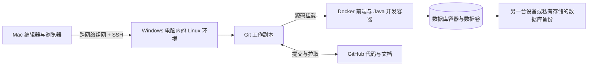
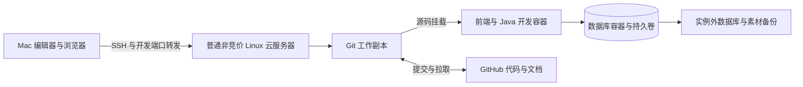

# 拾集 · 开发环境与部署历史

更新日期：2026-10-23  
状态：D072 优先复用 Mac 已有数据库、工具与缓存镜像，前端暂停；保留 D070 本地与取消交接，撤回 D071 的第二套数据库和前端容器。第 2 节起保留旧环境历史，不作为当前步骤。

## 1. 当前开发方向（D072）

已有 MySQL / Redis 直接用于项目连接准备，Compose 只留缓存工具、禁止自动拉取。项目账号/空库尚未配置；当前不开发前端或默认切换到完整后端。实际状态与命令见 [本地开发环境](17-本地开发环境.md)。原有数据库、Demo 和旧资源保留，Git、私有凭证与备份分别管理。

D069 云端路线、自有 Windows / VMware / Tailscale 安装与网络排查均保留为历史。用户曾反馈关闭 VPN 后云端 SSH 恢复，原因未进一步验证；当前不再推进分流配置。已租云资源不会因为改本地而自动停止计费，本轮未执行云端停机、释放或退订，未处理真实账单。

## 2. 历史云配置估算（非当前采购配置）

下表是根据本项目服务组合给出的工程估算，不是云厂商最低要求、性能保证或已选套餐。最终依据按量单价、实例类型、实际构建耗时及内存使用确定。

| 配置方向 | 适合的使用方式 | 取舍 |
| --- | --- | --- |
| 2 vCPU / 4 GB 内存 | 先做 Java、前端和数据库，分阶段启动组件 | 控制常驻服务与并行构建；远程 Java 分析、构建可能与服务争用内存 |
| 4 vCPU / 8 GB 内存 | Java 开发、数据库、前端构建 | 本项目完整远程开发的优先评估档位，仍需实测 |
| 历史云候选：8 vCPU / 16 GiB | Java 构建与服务、前端、开发数据库 | 资源较宽裕，按截图竞价方案评估；尚未做性能实测 |

早期磁盘估算为 60–100 GB；历史截图选择 50 GiB，可先评估精简开发是否够用，并控制镜像、依赖缓存和日志。历史竞价产品限制说明不直接套用于本轮非竞价采购：该产品不支持直接扩容系统盘和数据盘，不把后续原地扩盘作为默认方案。[产品限制](https://cloud.tencent.com/document/product/213/17816)

### 历史候选配置：来自 2026-10-17 用户截图

| 项目 | 截图显示 |
| --- | --- |
| 服务商 / 产品 | 腾讯云 CVM，竞价实例 |
| 地域 / 可用区 | 南京 / 南京三区 |
| 型号 | SA9.2XLARGE16，8 核、16 GiB |
| 竞价方式 | 跟随市场价格 |
| 系统盘 | 增强型 SSD 云硬盘，50 GiB |
| 数据盘 | 未设置 |
| 镜像 | Ubuntu Server 26.04 LTS 64 位；工具链兼容性待配置时核对 |
| 公网 | 按流量计费，带宽上限 20 Mbps |
| 配置费用显示值 | ¥0.31；下文暂按每小时估算，最终核对费用明细组成 |
| 公网流量显示值 | ¥0.80/GB |

这是采购候选的页面快照，未证明实例已开通，也不表示价格已锁定。截图中的 20 Mbps 是所选带宽上限，不是免费流量额度。

当前不运行 Agent、不调用模型 API，也不把 GPU 纳入实例预算。以后用户启用 Agent 时，优先评估外部模型 API；若选择本地推理，再单独评估显存、模型和成本。

Redis、RabbitMQ、OSS 均未确认纳入首轮。先跑必要服务，有明确功能时再增加；不为了列出中间件而全部常驻。

## 3. 历史竞价计费与成本估算（当前不采购）

历史上用户曾采用腾讯云竞价候选；D069 已明确本次不再采用竞价。竞价价格会变化，折扣针对 CPU 和内存；磁盘及网络等单独核对，不把截图配置费用直接称为完整账单。[腾讯云竞价产品说明](https://cloud.tencent.com/document/product/213/17816)

按截图显示值暂以 ¥0.31/小时作配置部分的算术估算：

| 使用情景 | 时长 | 配置费用估算，不含另计流量等费用 |
| --- | --- | --- |
| 每天 4 小时，每月 22 天 | 88 小时 | ¥27.28 |
| 每天 4 小时，每月 30 天 | 120 小时 | ¥37.20 |
| 持续运行 30 天 | 720 小时 | ¥223.20 |

按截图 ¥0.80/GB，10 GB 计费公网流量对应 ¥8。实际计费流量口径、配置费用是否包含所选磁盘、停机后的保留资源费用，需按订单明细及账单核对，避免重复相加或漏项。上述计算均不代表报价或固定月费。

开通前仍需核对：

| 需要核对 | 原因 |
| --- | --- |
| 最终地域、实例型号、CPU 与内存 | 当前有候选，最终提交和账单仍需对应 |
| 实例单价、计费周期、最低时长 | “按使用时间”可能有不同计费粒度和最小单位 |
| 普通停止、节省停机、释放实例的区别 | 是否停止计算费、能否保留资源，必须按具体产品核实 |
| 系统盘、数据盘、公网 IP、带宽或流量 | 需与计算资源分别核对，不能假定停机后所有费用归零 |
| 快照、备份、OSS、模型 API | 按所选服务另计，避免漏算 |
| 重启后的 IP、磁盘与实例可用性 | 影响 SSH、演示链接和开发恢复 |

估算公式：

```text
周期成本 ≈ 计算资源单价 × 计费时长
         + 磁盘 / IP / 网络 / 快照等适用费用
         + 实际使用的 OSS、模型 API 等费用
```

若市场价格、运行时长或附加资源变化，按实际发生值重新计算，不能把每天编辑代码的时长直接等同于服务器计费时长。

开发结束先保存提交与必要数据，再按已核实的停机方式处理实例。关闭 SSH 或编辑器只结束连接，不应作为“实例已停止计费”的依据。采购后记录预算、消费提醒和实际账单，再决定是否调整配置或使用方式。

### 日常关机是否停止计费

2026-10-17 核对：腾讯云国内站竞价实例 FAQ 当前标明支持“关机不收费”；尚未在用户实际实例上验证关机选项或账单。[竞价实例 FAQ](https://cloud.tencent.com/document/product/213/17817)

| 操作 | 费用判断 |
| --- | --- |
| 关闭编辑器、断开 SSH、停止 Java 等应用 | 不等于停止实例，也不等于停止实例计费 |
| 普通关机或在系统内执行关机命令 | 不能当作已经启用停费模式 |
| 控制台关机时明确选择“关机不收费”，且该实例支持并执行成功 | 停止计算资源费用；保留的云盘等组件仍需分别计费 |
| 销毁 / 释放实例 | 与关机不同，涉及资源及数据释放，不作为保留开发环境的日常关机方式 |

操作参考为控制台实例的关机弹窗，确认所选模式是“关机不收费”。通用操作文档描述了该模式及收费范围，但页面面向按量云盘实例；竞价支持情况结合国内竞价 FAQ 与具体实例弹窗核对。没有该选项时，不按停机就停费估算，先向腾讯云确认。[关机操作](https://cloud.tencent.com/document/product/213/19922)、[收费范围与限制](https://cloud.tencent.com/document/product/213/19918)

用户当前选择的是按流量计费，后续仍需核对计费流量、系统盘及其他保留资源的费用。前表按 4 小时计算的金额仅为配置价格的情景估算，不代表其余 20 小时保留资源免费。实际停机后用账单确认计算项停止计费及仍在计费的项目，再更新成本记录。

### 竞价回收对本项目的影响

腾讯云当前产品说明明确：库存不足可能回收实例，实例内业务数据不保留。因此竞价实例适合本项目可中断、可恢复的开发阶段；长期稳定展示及不可丢失的数据库另行规划。[回收规则](https://cloud.tencent.com/document/product/213/17816)

本项目实施建议：

- 完成一个小任务就提交并推送代码及文档；只有实例本地的 Git 提交不足以防止实例丢失。未提交但有价值的工作同步到本地或独立备份。
- 开发数据库可以同机临时运行，但必须能从迁移和种子数据重建。需要保留的手工测试数据做实例外备份；对不可丢失的数据再选择独立数据库或持久化方案。
- 普通 Docker volume 若落在被释放的实例磁盘上，不能代替实例外备份。把备份保存在同一系统盘上也不满足恢复要求。
- 商品素材及重要上传文件保留本地或独立对象存储副本；依赖缓存、镜像和日志可按需要重新生成。
- 先准备并验证环境初始化、依赖安装、迁移、种子和启动步骤，再依赖远程开发；实例被回收后重新申请、拉取仓库并恢复环境。
- 回收通知和元数据查询可作为辅助，不把临近回收时临时保存当成唯一保障。[回收状态查询](https://cloud.tencent.com/document/product/213/37970)

这些恢复能力目前尚未实现，不承诺重建耗时。首轮不因采用竞价就默认采购额外托管数据库或复杂高可用设施。

## 4. 服务与数据放在哪里

| 内容 | 首轮建议位置 | 说明 |
| --- | --- | --- |
| 前端 / Java 源码 | Linux 开发工作副本（建议） | 经 Git 同步；不靠手工上传多个最终版压缩包 |
| JDK、构建与前端工具 | 对应开发容器及独立依赖缓存 | 宿主机提供 Docker，工具链镜像锁定版本并可重建 |
| 数据库（产品待选） | Linux 数据库容器与数据卷 | 迁移和种子进仓库，需要保留的数据另存物理机器之外的备份；同机卷不能抵御整机磁盘故障 |
| Agent（后续候选） | 当前不创建或部署 | 用户以后启用时再选型，通过受限 API 复用商城查询能力 |
| 图片 | 首轮开发存储接口，后续按需 OSS | 头像、店铺标识和商品图分别校验归属 |
| 文档 / 契约 / 示例配置 | Git 仓库 | 与功能变更同步提交 |
| 密码、私钥、模型及云服务密钥 | 受控环境配置 | 只提交无秘密的配置模板 |
| 数据备份 | Mac、外置设备或私有远程存储 | Git 不代替数据库与图片备份；不能只有开发云实例内的一份副本 |

Linux 开发环境继续采用 Docker 容器开发，默认通过 Compose 管理前端、Java 和数据库；中间件按需接入，当前不创建 Agent 容器。开发配置挂载源码并提供编译、调试能力，演示配置运行固定产物；详细划分见 [Docker 容器开发](10-Docker容器开发.md)。Docker 官方支持在共同 Compose 定义上叠加不同环境配置。[环境配置说明](https://docs.docker.com/compose/how-tos/production/)

## 5. 开发访问与公网展示

开发阶段通过 SSH 和端口转发访问预览，数据库不直接发布公网端口。SSH 限制来源并使用专用开发账号，应用服务不依赖管理员账号运行。

前端开发端口、Java 调试端口和数据库管理入口不作为公开演示地址。容器需要宿主机访问时明确绑定范围，不能只因使用 Docker 就假定端口没有对外开放。[Docker 端口发布说明](https://docs.docker.com/engine/network/port-publishing/)

后续需要公网展示时，单独增加反向代理、HTTPS 和发布配置。开发与演示至少分开工作目录、配置、数据库及持久化卷；同机可以节约环境数量，但不能消除 CPU、内存和故障的相互影响。

组网后的开发地址仅供已授权设备访问，不等于可分享给任意人的公网演示网站。需要公开作品地址时再单独评估发布；当前云端方案不依赖家中 Windows 电脑运行，但实例停机或网络故障仍会影响服务。

开发使用源码和调试配置；演示使用明确提交构建的产物。用户可见页面与 README 需要标注模拟支付、演示数据与实际可用范围。公网域名及对外访问要求在选定地域与服务后另行核对。

## 6. GitHub 与日常流程

1. 工程接入后确定仓库组织，建议 README、docs、契约和实现放在同一版本链中。
2. 在选定的主要工作副本拉取仓库、建立开发分支，再进行代码与文档修改；远程编辑建议使用 Linux 工作副本。
3. 验证当前变更，同轮更新说明、功能状态与决策；不要求每次按键都产生提交。
4. 提交并推送已准备好的版本；GitHub 仓库创建、公开可见性及推送另按用户安排执行，当前尚未操作。
5. 若有独立演示环境，从确定提交构建和发布；不直接覆盖正在使用的开发工作副本。

当前规划目录会继承上层目录的 Git 仓库，尚未建立拾集的独立仓库。首次同步前，确认 Git 根目录和远程地址只属于本项目；不要直接在继承的上层仓库执行批量暂存或推送。本轮只更新文件，未修改上层仓库或远程配置。

仓库提交配置模板，真实环境文件、密钥、数据库文件、上传数据和日志纳入忽略规则。`.gitignore` 只影响未被跟踪的内容；已跟踪的秘密不能靠新增忽略规则撤回。[GitHub 忽略文件说明](https://docs.github.com/en/get-started/git-basics/ignoring-files)

建议目录如下，仅为后续工程组织示意：

```text
shiji/
  README.md
  docs/
  frontend/
  backend-java/
  contracts/
  deploy/
    compose.yaml
    compose.dev.yaml
    compose.demo.yaml
    .env.example
```

### 6.1 个人开发时，代码从哪里上传

本地编辑器通过 SSH 打开服务器上的工程目录，修改实际写在服务器 Git 工作副本中；源码再挂载进开发容器，容器负责构建、运行和调试。在服务器宿主机的项目目录里检查改动、选择文件暂存（git add）、提交（git commit）并推送（git push），GitHub 才收到这些提交。只保存文件或只提交到服务器本地仓库，不等于已经上传。

首次需要独立项目仓库、正确的远程地址和 GitHub 认证。SSH 密钥或 HTTPS 认证具体选哪种留到接入时确定；凭证不写入工程配置或 Git 远程 URL。GitHub 的公开/私有可见性由用户决定。当前目录仍继承上层仓库，这里只说明未来流程，未执行初始化、认证、提交或推送。[GitHub 上传说明](https://docs.github.com/en/migrations/importing-source-code/using-the-command-line-to-import-source-code/adding-locally-hosted-code-to-github)、[SSH 连接](https://docs.github.com/en/authentication/connecting-to-github-with-ssh)

### 6.2 数据库哪些内容进 GitHub

| 内容 | 保存方式 |
| --- | --- |
| 表、字段、索引及结构变更 | 迁移脚本进 Git，与对应代码一起提交 |
| 分类、虚构商品等可公开演示数据 | 无秘密、可重复导入的种子脚本进 Git，开发/演示环境显式加载 |
| 运行中新增的用户、订单等数据 | 数据库保存，需保留时导出备份到本机或私有实例外存储，不提交业务全量备份到 Git |
| 数据库密码、真实环境配置 | 受控环境配置，仓库仅提供无秘密模板 |
| 上传的商品图片等文件 | 本地受控目录/对象存储保存，另做实例外副本；数据库备份里的 URL 不等于备份了图片 |

例如未来迁移文件可能叫 `V1__init_schema.sql`、`V2__add_product_index.sql`，这里只是命名示意，尚未生成 SQL 或选择迁移工具。新增结构变更追加新版本，已在共享环境执行的版本不随意改写；目标环境执行尚未应用的迁移，保留已有业务数据。Flyway 是 Java 阶段的可选方案，本轮不冻结选型。[版本迁移说明](https://documentation.red-gate.com/flyway/flyway-concepts/migrations/versioned-migrations)

迁移脚本解决“数据库应该长什么样”；备份解决“保留当时已有的数据”。二者用途不同。开发环境已有备份或手工测试数据时，不能每次更新都删库再导初始化脚本，种子也不在每次应用重启时自动重复导入。

### 6.3 数据迁移、备份与恢复

小型开发库需要保留数据时，通常使用数据库导出工具生成一致性备份，再传到实例外保存；另一台机器启动兼容数据库后导入。例如 PostgreSQL 可用 pg_dump 导出，归档格式用 pg_restore 恢复，纯 SQL 用 psql；MySQL 有 mysqldump 及相应导入工具。数据库产品、版本、服务名和凭证尚未确定，本轮不提供声称可直接运行的备份命令。[PostgreSQL 导出](https://www.postgresql.org/docs/current/app-pgdump.html)、[MySQL 备份与恢复](https://dev.mysql.com/doc/refman/8.4/en/using-mysqldump.html)

恢复分两种：空开发库按迁移＋种子重建；要保留原业务数据时，先把包含结构与数据的备份恢复到隔离目标库，再按其迁移历史应用尚未执行的版本，不把全量初始化和全量恢复重复叠加。备份范围须含应用所需表及迁移历史；账号权限等实例配置和上传图片另行管理。恢复后核对结构、关键记录及图片引用，不能只检查备份文件存在。

本地 Docker 命名卷可跨容器重建保留数据，但仍在服务器磁盘上；当前自有电脑方案也需整机之外的备份，历史竞价方案则需实例之外的副本。恢复最多覆盖最后一次成功备份保留的数据，未推送代码和备份之后的数据不凭空恢复。不要把运行中的数据库数据目录直接打包，作为默认的一致性备份方式。[Docker 数据卷](https://docs.docker.com/engine/storage/volumes/)

### 6.4 从个人开发到发布

个人阶段建议：完成一个小功能，验证后把代码、相关迁移及说明一起推送；有价值的测试数据单独备份。展示环境拉取指定提交，构建应用并更新应用容器，执行待应用迁移，沿用该环境自己的数据库和数据卷。开发库和演示库各自保存业务数据，不把开发全量备份作为每次发布的覆盖内容。

以后需要自动化时，再增加“推送 → 检查/构建 → 镜像仓库 → 部署”的流水线；推送到 GitHub 本身不会自动更新运行服务或数据库。当前不用为个人开发预先搭建这条流水线。以上为 P042 实施建议，尚未创建仓库、迁移、备份脚本或远程环境。

## 7. 自有电脑方案的落地顺序（待执行）

1. 核对 Windows 11 具体版本、CPU 虚拟化支持、磁盘空间和两端网络，选择虚拟机或 WSL2。
2. 安装 Linux，建立专用开发账号和 SSH；选择跨网组网方式，仅开放所需权限。
3. 先验证 Mac 到 Linux 的连接、SSH 登录、端口转发，以及 Windows 重启和无人值守后的可达性。
4. 确定项目独立仓库及主要工作副本，再配置 GitHub 认证；当前继承上层仓库，不能直接批量提交。
5. 在 Linux 准备 Docker Engine 与 Compose，工程接入后编写镜像、源码挂载、数据卷和调试配置。
6. 验证开发页面、数据库迁移、应用容器重建保留数据，并把重要数据与图片备份到另一台设备或私有存储。
7. 公网作品展示另行评估，当前不配置公网发布或 Agent。

以上均为计划，没有连接或修改另一台电脑，没有安装组网软件、Linux 或 Docker。

本节保存 D067 / D068 的自有电脑安装与排查历史；当前路线以第 1 节和 D069 为准，不继续执行此路线，也不删除已有环境。

### 历史自有电脑方案（D067，已由 D069 替换）

已确认方向是 Mac 作为操作端，另一台电脑承载 Linux 和 Docker；保留 Compose 管理前端、Java 和数据库的方案。

**当前路线：Windows 11 → VMware 中的 Ubuntu Server → Docker Engine + Compose（版本已确认，测试容器待验证）；Mac 与 Linux 虚拟机通过 Tailscale 组网后使用普通 SSH（已从截图确认一次登录成功）。** Tailscale 安装在 Mac 与 Linux 客体内，Linux 仍需启动 SSH 服务及配置访问权限；只装在 Windows 宿主机上不会自动打通客体。组网提供连接，SSH 提供登录，两者职责不同。[连接设备](https://tailscale.com/docs/how-to/connect-to-devices)、[SSH 网络连接](https://tailscale.com/docs/reference/ssh-over-tailscale)



| Linux 运行方式 | 本项目评估 |
| --- | --- |
| Linux 虚拟机 | 当前已进入 VMware / Ubuntu 路线，截图确认客体成功启动及本机登录；Mac 到客体的 Tailscale 地址 SSH 登录已从截图确认；容器、重启恢复待验证 |
| WSL2 | 可行备选，适合同时使用 Windows；需配置启动及跨机网络，不能把 Windows 本机 localhost 可用当成 Mac 已能访问 |
| 直接安装 Linux | 适合以后确定专用服务器时评估，涉及现有系统及磁盘处理，本轮不实施 |

WSL2 默认 NAT 网络下，其他电脑访问需要额外配置；Windows 11 22H2 及以上可评估镜像网络，仍需核对防火墙。[Microsoft 网络说明](https://learn.microsoft.com/en-us/windows/wsl/networking)

虚拟机资源建议先评估 4 个虚拟 CPU、8 GB 内存；虚拟磁盘按 D068 先设 30 GB，均是起步估算，需检查实际 CPU、SSD 可用空间及构建占用；保留 Windows 运行空间，不把全部 16 GB 分给客体。Windows 及 Linux 必须保持运行且联网，自动休眠、重启和开机后的服务启动要实际验证。无需为此预先安装 Windows 内的另一套 Docker。

两端不在同一局域网，因此不把家中 192.168.x.x 地址直接当作远程入口。当前使用 Tailscale 组网，不要求默认购买公网 IP 或把 SSH、数据库、Docker 管理端口暴露到公网；直连不通时可能中继，延迟和带宽需用两端实际网络验证。[连接机制](https://tailscale.com/docs/reference/device-connectivity)

编辑方式建议保持“Mac 编辑界面 + SSH 打开 Linux 上的工程 + 容器构建调试”，避免每天手工传源码。Remote - SSH 可以直接打开远程目录，但不会自动同步 Mac 当前目录；编辑器和认证方式尚未确定。[远程编辑说明](https://code.visualstudio.com/docs/remote/ssh)

若用户更希望代码真正存放、编辑在 Mac，本地开发后通过 Git 同步到 Linux 运行也可行，这是另一种流程，不能把 Mac 路径直接挂给远程 Docker。正式接入时选择一个主要工作副本，当前规划目录不会因 SSH 连接自动迁移。[挂载边界](https://docs.docker.com/engine/storage/bind-mounts/)


### 7.1 Linux 与组网的安装指引（P043，待用户执行）

进度更新（2026-10-21）：用户在 Mac Tailscale 引导截图后确认安装完成。当前仅记录用户反馈的 Mac 客户端安装状态；账号登录、在线状态、Windows 虚拟机、Linux 客户端与跨网 SSH 连通尚未核验。后续从实际安装进度继续，不重复要求下载安装 Mac 客户端。

后续进度（2026-10-21）：用户明确 VMware 已安装；尚待下载 Ubuntu ISO 并安装客体。建议 Ubuntu Server 24.04 LTS 的维护版镜像，常见 Intel/AMD Windows 电脑选择 live-server-amd64.iso；并非将 ISO 作为 Windows 安装程序运行，需在 VMware 新建虚拟机内挂载启动。具体 VMware 版本、CPU 架构、Ubuntu 安装和联网仍未核验。

2026-10-20 用户要求推进 Windows 配置 Linux 及两端组网。本节提供人工安装指引，官方安装方式已核对，但没有在用户 Windows 或 Linux 上执行。当前建议 VMware Workstation Pro + Ubuntu Server 24.04 LTS + Tailscale；这不表示用户已选择所有软件或完成安装。以下按 Windows 电脑为 Intel / AMD 的 x86-64 架构说明，若是 Windows on ARM，需另选兼容虚拟化软件及镜像。

| 安装位置 | 要准备的内容 | 官方入口 |
| --- | --- | --- |
| Windows | VMware Workstation Pro，下载 Windows 版本 | [Broadcom 下载与许可说明](https://knowledge.broadcom.com/external/article/368667/download-and-license-free-vmware-desktop.html) |
| Windows，供虚拟机挂载 | Ubuntu Server 24.04 LTS 的 live-server-amd64.iso，选该系列可用的维护版本 | [Ubuntu 24.04 镜像](https://releases.ubuntu.com/24.04/) |
| Mac | Tailscale，选择官方独立安装包，按引导允许 VPN 配置 | [macOS 安装说明](https://tailscale.com/docs/install/mac) |
| Linux 虚拟机 | Linux 版 Tailscale，安装后登录与 Mac 同一网络 | [Linux 安装说明](https://tailscale.com/docs/install/linux) |

VMware 当前官方提供免费版本，下载可能需要 Broadcom 账号及资料审核。不使用非官方破解安装包；下载遇到审核或虚拟化兼容问题时，再选择其他虚拟机软件，避免同时装多套反复切换。Mac 不需要安装虚拟机软件；Windows 宿主机不必为了本流程再装 Tailscale，组网终点是 Linux 客体。

2026-10-21：用户反馈 Broadcom 登录流程繁琐，补充 [VirtualBox 官方下载入口](https://www.virtualbox.org/wiki/Downloads) 作为免登录下载的替代建议，选择 Windows hosts 基础安装包即可；Ubuntu Server、Docker 及 Mac/Linux 组网方向不变。尚未收到用户选定或安装 VirtualBox 的确认，VMware 不是强制依赖。

安装顺序：

1. Windows 任务管理器的 CPU 页面核对“虚拟化”是否已启用，并检查 SSD 可用空间；未启用时按机器厂商指引处理 BIOS/UEFI 设置。
2. 安装 VMware，创建新的 Linux 虚拟机，挂载 Ubuntu Server ISO。资源建议 8 GB 内存、总共 4 个虚拟 CPU、按 D068 先设 30 GB 虚拟磁盘；网络先用 NAT，核对 Linux 能上网。
3. 在虚拟机窗口内完成 Ubuntu 安装，使用普通开发账号；存储选择仅针对新建虚拟磁盘，不给虚拟机直通 Windows 真实磁盘。按安装器选项安装 OpenSSH server，额外服务暂不选。安装完成后卸载 ISO 并从虚拟磁盘启动。[Ubuntu 安装资料](https://ubuntu.com/server/docs/tutorial/)、[OpenSSH 说明](https://ubuntu.com/server/docs/how-to/security/openssh-server/)
4. 在 Mac 安装 Tailscale 并登录；在 Linux 依据官方指南安装 Tailscale，再完成登录。当前按普通 OpenSSH 连接，不要求额外启用 Tailscale SSH 功能，不配置出口节点或子网路由。
5. 在 Tailscale 设备列表确认 Mac 与 Linux 均在线，记下 Linux 的组网地址；两端在同一个 tailnet 中，并允许 Mac 访问 Linux 的 SSH 端口。
6. 用 Mac 终端尝试普通 SSH 登录，命令形式为 `ssh 开发用户名@Linux的组网地址`，这只是需要替换参数的示意。首次连接核对主机指纹，登录应使用 Linux 账号的认证方式，而不是 Tailscale 登录密码。连通后再配置 SSH 密钥及远程编辑器。
7. 验证 Windows 不休眠、Linux 保持启动；Windows 重启后的虚拟机及网络自动恢复另行配置和实测。SSH 连通只证明远程通道可用，此时尚未部署商城网页。

官方 Linux 指南包含安装与登录命令；本节不把尚未核对的客体环境写成已验证的项目安装脚本。遇到问题时先提供失败步骤和错误文本，不发送密码、认证链接或私钥。Docker、GitHub 认证与项目迁移在 SSH 通道验证之后继续。

### 7.2 在 VMware 中挂载 Ubuntu 镜像（待用户执行）

截图核对（2026-10-21）：已从用户引用对话的附件看到 VMware 中 shiji-dev 的 Ubuntu 安装器，包含语言选择及 Keyboard configuration 页面，后者 Layout / Variant 均为 English (US)，底部 Done 已高亮。仅确认虚拟机已从安装介质进入安装器，不代表 Ubuntu 已安装或远程连接已打通。

后续截图显示普通 Ubuntu Server 已选中，随后 Network configuration 中 ens33 已通过 DHCPv4 获得私网地址；当前建议保留自动网络设置并继续。获得地址仅说明 DHCP 已配置，不单凭此确认外网、软件源或 Tailscale/SSH 可达，安装尚未完成。

软件源截图进一步显示“This mirror location passed tests”，且测试日志成功获取 noble / updates / backports 索引，日志请求指向清华镜像站；可保留当前输入并继续 Done。此仅为安装器当次软件源检查通过，不代表所有外网服务或跨网 SSH 已验证。

存储截图显示 Guided storage configuration，目标 /dev/sda 为 30.000G，与 D068 容量一致。当前人工安装建议保留 Use an entire disk、取消默认选中的 Set up this disk as an LVM group，使用简单分区；不勾选 LUKS 加密。继续后先核对分区摘要，根分区使用扣除启动分区后的主要空间。该建议尚未收到用户实际应用或写盘完成的反馈，不记为分区完成。

随后分区摘要截图确认：30.000G 的 /dev/sda 拟分为 1.000M BIOS grub spacer 和 29.997G ext4 根分区 /，无 LVM，磁盘空间已分配。摘要与本次简单分区建议一致；可由用户继续 Done 并在确认框核对目标后接受写盘。此时仅核对待应用布局，尚无实际格式化或安装完成的验证。

最新截图已到 Featured server snaps，所有可选项为空；建议不选额外 snaps，继续 Done 等待安装。未读取到 SSH setup 截图，不能据后续页面推定 OpenSSH 已选中或可用；首次登录后再核查。Ubuntu 安装及重启完成仍待反馈。

D068（2026-10-21）：用户选择先用 30 GB，取代之前 80–100 GB 的宽裕预留建议。30 GB 为精简起步容量，后续根据 Ubuntu、Docker 镜像、构建缓存、日志与数据库的实际占用评估，不承诺足以容纳所有后续组件。扩容需配套处理客体分区/文件系统（如使用 LVM 也需调整对应层），未执行扩容或清理。

2026-10-21 用户进一步确认 VMware 和镜像均已下载，结合此前反馈，VMware 已安装。ISO 实际版本及完整性、虚拟机创建和客体安装尚未核验；当前按下载的 Ubuntu Server 24.04 系列 ISO 指导，不记录为安装完成。

建议通过手动安装路线：打开 VMware，新建虚拟机，选“典型”，再选“稍后安装操作系统”；客体选择 Linux / Ubuntu 64 位。这样先创建空虚拟磁盘，再挂载 ISO 启动 Ubuntu 安装器，不依赖 VMware 简易安装自动填入账号。[VMware 创建虚拟机说明](https://knowledge.broadcom.com/external/article/315434/create-virtual-machines-in-vmware-workst.html)

虚拟机名称可用 shiji-dev，目录选择 Windows 有足够空间的位置；磁盘按 D068 先设 30 GB，使用虚拟磁盘文件，不选物理磁盘。自定义硬件时，内存先设 8192 MB，CPU 目标总共 4 个虚拟核心（如一个处理器、每个处理器四核，仍需宿主 CPU 支持），网络 NAT。在 CD/DVD 设备中选“使用 ISO 映像文件”，浏览选择下载的 Ubuntu .iso，勾选“启动时连接”。无需为了运行 Linux Docker 容器预先启用嵌套虚拟化。

完成向导并启动虚拟机，从 ISO 进入 Ubuntu 安装器；如显示启动菜单，选择 Try or Install Ubuntu Server。后续依据实际安装画面设置语言、网络、虚拟磁盘及普通开发账号，并按前节安装 OpenSSH。键鼠需要从虚拟机释放时，Workstation 默认可用 Ctrl+Alt。以上为人工指引，未远程操作或验证启动。

### 7.3 Ubuntu 首次登录后的组网准备（待用户执行）

可读性建议（2026-10-21）：用户反馈 VMware 内控制台字体过小，暂先调整字体再继续认证。在 Ubuntu 本机 tty 可用 `sudo dpkg-reconfigure console-setup` 打开配置，编码保留 UTF-8、字符集可保持默认，字体建议 Terminus、尺寸先试 16x32；如尚未即时生效，再在该 tty 执行 `sudo setupcon`。这是显示设置建议，不表示已应用或认证链接 404 的原因已确认为过期；没有改桌面环境或网络参数。[Ubuntu console-setup 手册](https://manpages.ubuntu.com/manpages/noble/man5/console-setup.5.html)、[setupcon 手册](https://manpages.ubuntu.com/manpages/noble/man1/setupcon.1.html)

2026-10-21 最新截图确认安装后的 Ubuntu 24.04.5 LTS、x86-64、内核 6.8.0-147-generic，已出现正常用户 shell 提示符；根分区显示约 29.36 GB，使用率约 22.8%。这是截图核对结果，不代表已执行远程检查；私人用户名、主机名、IP 和密码不写入公开说明。

下一步在 Ubuntu 虚拟机内逐条执行以下准备与官方安装命令；这些命令尚未在用户设备运行验证，某一步失败时先处理该步，不继续把后续结果视为成功：

```bash
sudo apt update
sudo apt install -y curl ca-certificates
curl -fsSL https://tailscale.com/install.sh | sh
sudo tailscale up
```

安装与登录方式依据 [Tailscale Linux 官方说明](https://tailscale.com/docs/install/linux)。sudo 密码由用户自行输入，终端不回显字符；打开 tailscale up 提供的认证链接，用 Mac 所在的同一个 tailnet 登录。认证链接不写入仓库或公开日志。这里使用普通 OpenSSH，不启用额外 Tailscale SSH、出口节点或子网路由。

认证排查进度（2026-10-21）：用户浏览器截图显示 Tailscale 认证链接 404，页面提示链接找不到、可能已过期；也需排查链接复制/输入不完整，当前不判定安装失败或组网成功。建议回到 VMware 的 Ubuntu 本机终端，中断仍等待的登录命令，再执行 `sudo tailscale up --force-reauth` 重新发起认证，及时完整打开最新输出的 URL，使用 Mac 同一 tailnet 的账号。该命令会重新认证设备，后续已有远程连接时不能不加判断套用。本轮未执行命令，恢复结果待反馈。[官方参数说明](https://tailscale.com/docs/reference/tailscale-cli/up)

2026-10-21 后续截图显示 Login successful，确认 Linux 设备已完成浏览器授权并加入对应 tailnet；不记录私人账号或设备名。终端组网地址、持续在线、SSH 服务和 Mac 到 Linux 登录尚未验证，下一步执行以下核对。

完成登录后核对：

```bash
tailscale ip -4
systemctl is-active ssh
```

前者取得 Linux 的组网地址，后者若输出 active，表示 SSH 服务正在运行；inactive、failed 或未安装均需分别处理。两端在线后，再从 Mac 用实际 Linux 用户名与组网地址发起 SSH，核对主机指纹并登录，才能记为跨网通道验证通过。当前没有执行上述命令或配置 Docker。

2026-10-21 用户反馈 tailscale ip 已返回组网 IPv4，ssh.service 为 inactive；不在公开文档记录真实地址。inactive 不能单独判定 SSH 未安装或端口不可用，Ubuntu 24.04 也可能使用 ssh.socket 按需启动。本次建议从 VMware 本机终端执行 `sudo systemctl start ssh`，随后再查 `systemctl is-active ssh`；若服务单元不存在或启动失败，先取错误原文再按实际情况安装 OpenSSH 或排查配置，不默认重装或关闭防火墙。服务就绪后从 Mac 尝试普通 SSH，首次核对主机指纹；Ubuntu 可用 `ssh-keygen -lf /etc/ssh/ssh_host_ed25519_key.pub` 查看 ED25519 指纹。此步骤尚未执行或验收，自动启动配置另待核查。

### 7.4 Mac 到 Ubuntu 的首次 SSH 登录记录

2026-10-21 用户提供 Mac Terminal 截图，显示通过 Linux 的 Tailscale 地址建立 SSH、接受首次主机密钥提示、完成密码认证，出现 Ubuntu 24.04.5 LTS 欢迎信息及交互 shell。由此确认本次普通 SSH 登录可用；截图未显示独立核对服务器指纹的过程，不将其写为已验证。记录不含真实用户名、主机名、IP、账号或凭证。

此后在该 SSH 会话执行的命令作用于 Linux，Mac 提供终端界面。可在 Mac 终端复制粘贴命令和调整终端字号；开发时 Windows 及 Ubuntu 虚拟机仍需运行、组网在线。一次登录不证明休眠/重启后的自动恢复、长期可用、端口转发或网页访问已经完成。

下一阶段在 Ubuntu 内配置 Docker Engine 与 Compose，已提供 [Ubuntu 仓库安装与核验指引 P044](10-Docker容器开发.md#8-ubuntu-主机安装与核验指引p044待用户执行)，现已由用户输出确认 Docker Engine 29.1.3 Client/Server 与 Compose 2.40.3；hello-world 拉取/运行尚未通过验证。当前未创建商城工程、配置远程编辑器或部署网页。桌面原型仍是本地 HTML，不能把 SSH 成功记为商城后端验收。

### 7.5 日常断开、关机与下次连接

2026-10-22 用户反馈：昨天断开后，今天已重新连接成功。仅确认一次断连后的 SSH 恢复，不据此推定 Windows/虚拟机重启、服务自启动或无人值守恢复已验收。

2026-10-21 用户要求先说明连接生命周期，Docker 安装暂不继续指导；已有安装命令仍是待执行状态，不据本轮提问认定 Docker 已安装。

| 操作或状态 | 对连接的影响 |
| --- | --- |
| Mac 关闭 SSH 终端或执行 exit | 本次 SSH 会话结束；不关闭 Linux，条件满足时可以重新登录 |
| Mac 的 Tailscale 断开、Mac 断网或休眠 | 当前组网连接受影响；恢复联网及 Tailscale Connected 后重新发起 SSH |
| Ubuntu 虚拟机关机、挂起，或 Windows 关机/休眠/断网 | Linux 当前无法正常被远程访问；先恢复 Windows、Linux 和联网，再核查 Tailscale / SSH |
| 仅最小化 VMware 窗口，客体继续运行 | 不因窗口最小化而中断连接；关闭窗口须看 VMware 实际选择的是后台运行、挂起还是关机 |
| 隐藏 Mac Tailscale 窗口，后台仍 Connected | 不必一直展示窗口，组网连接仍可用；退出/断开客户端与关窗口须区分 |

Mac Tailscale 客户端负责把 Mac 接入与 Linux 相同的加密虚拟网络；SSH 在这个网络之上提供命令行登录。它不是用于远程给 Windows/Ubuntu 开机的工具，也不是镜像下载软件。当前未设置出口节点，不需要为了连接服务器额外启用该功能。

正常下次使用：Windows 和 Linux 先运行并联网 → Linux 的 Tailscale / SSH 可用 → Mac Tailscale Connected → 用原 Linux 用户名与组网 IP 重新执行 SSH。无需每次生成新 IP 或重做网页认证；旧 SSH 终端会话不保证自动续回，重新连接后是新的登录会话。

Tailscale 地址在同一节点保持注册且管理员未修改地址时保持稳定，普通关机、重启和换网络不要求重新生成地址。删除设备、重置/重装 Tailscale、丢失设备状态或手动改地址等情况下可能变化，应重新核对；此前浏览器认证 URL 是临时授权链接，不是 SSH 连接地址。[地址规则](https://tailscale.com/docs/concepts/ip-and-dns-addresses)

设备认证过期时可能需要重新授权，不能承诺永久免登录；不默认关闭密钥过期机制，也不每次重连就强制重新认证。[认证过期说明](https://tailscale.com/docs/features/access-control/key-expiry)

当前已确认一次 SSH 登录，Windows/虚拟机开机启动、Linux Tailscale 与 SSH 自启及关机后重新连接尚未实测。后续须核查这些服务和实际恢复流程，不能把上述正常预期写成已完成自启配置。

## 8. 实施时要补齐的记录

- 物理机配置、Windows 具体版本、Linux 运行方式、虚拟机资源分配和跨网连接方式。
- 操作系统、CPU 架构、JDK / Spring、Node、Python、数据库与容器版本。
- 仓库路径约定、配置模板、实际启动与停止命令。
- 健康检查、日志查看、备份及恢复验证。
- 实测构建时间、常驻内存、网络延迟及主机休眠/重启后的恢复情况，再调整资源。

原云服务资料核对日期为 2026-10-17；第 6 节 GitHub、迁移及备份官方资料于 2026-10-20 补核对。资源配置、目录、备份周期与具体工具仍属实施建议，实际环境尚未验证。

2026-10-20：按 D067 切换当前开发方向，新增自有电脑与跨网连接建议；官方网络与远程编辑资料已核对，实际环境尚未验证。

## 9. 当前采购与接入进度（D069）

2026-10-22 已确认非竞价云服务器、月预算 100 元以内和云端编译调试；仅完成需求及官方资料核对。待确认产品/地域/付款周期/规格、镜像来源及远程编辑工具，再依实际实例配置 SSH、Docker/Compose、仓库及备份。尚未购买、安装、迁移或进行容器/接口验收。

### 9.1 用户提供的普通按量候选（2026-10-22，未开通）

截图为腾讯云 CVM 普通按量计费，南京/南京三区，SA9.LARGE8（4 vCPU / 8 GiB），Ubuntu Server 24.04 LTS 64 位，通用型 SSD 系统盘 50 GiB，未设数据盘，购买公网 IP、按流量计费、带宽峰值 20 Mbps。默认 VPC/子网，不要求为当前单机开发另建网络。

配置费用显示 ¥0.56、公网流量 ¥0.80/GB；截图未展开配置单价单位及费用组成，先核对费用明细。若 ¥0.56 为小时配置单价，持续计费 30 天对应 ¥403.20，仅该部分即超过 D069 月预算；流量及未包含的资源另计。20 Mbps 是峰值带宽，不是免费流量额度。按量是非竞价方案，但不等于固定包月，不能将每日编辑时长当作实际计费时长；停机/保留资源费用按产品核实。预算不变时优先比较轻量云或包年包月实际成交总额，不认定用户已接受此候选价格。

截图安全组当前全选常用项。针对本项目首轮单机开发的建议：保留 TCP 22，来源限制为当前可信公网 IP；ICMP 按调试需要保留；取消 Windows RDP 3389；80/443 等公网发布时再开放，SSH 转发开发预览无需先开；单机暂无内网互通需求时不选通用内网放通。入站不放通 443 不等于阻止 Docker 出站下载，出站规则另行核对。数据库与 Docker 管理口不公开。标签可留空，IPv6 暂不作为部署前提。[腾讯云安全组配置](https://cloud.tencent.com/document/product/213/15377)、[计费概述](https://cloud.tencent.cn/document/product/213/2179)

以上仅截图复核与建议，没有替用户下单、修改安全组或配置云实例。

### 9.2 云端连接反馈与首轮核对（2026-10-22）

用户反馈已用 FinalShell 连接；这是用户报告的连接进度，尚未取得云端终端输出。云端实例与旧 VMware 机器分开验收，主机安全基础版是否安装也未获确认。下一步在该云服务器的 FinalShell SSH 终端依次执行只读核对：

```bash
cat /etc/os-release
uname -m
sudo docker version
sudo docker compose version
```

当前未执行以上命令；若提示 Docker 或 Compose 不存在，保留原始输出后依实际系统安装，不视为故障或重装理由。版本/API、镜像仓库连通及测试容器分别验证；不据 FinalShell 连接认定账单符合预算、代理已配置或商城可运行。

### 9.3 FinalShell 远端关闭连接（2026-10-22）

后续截图显示 FinalShell 多次报 `connection is closed by foreign host`，未见登录后 shell 或远端资源数据；更新当前状态为“云端 SSH 成功登录尚未确认”，不沿用早先口头反馈作为验收。用户所在城市与云实例地域不同不会直接禁止公网 SSH，地域影响路径与延迟，具体错误仍需诊断。

先核对 FinalShell 主机为控制台公网地址、端口为实际 SSH 端口（默认 22）、Ubuntu 默认用户名为 `ubuntu`（自定义用户依实例实际配置），认证方式与创建时选择的密码或密钥一致，不沿用旧 VMware 账号密码。核对实例运行状态及安全组 TCP 22 对当前可信公网出口的放通规则。再用 Mac 原生 SSH 的 `ssh -v -o ConnectTimeout=10 ubuntu@<实例公网IP>` 对照，收集断开前日志区分网络、握手和认证阶段；后续用户已执行，阶段判定见下文。不因错误直接开 root 登录、关闭防火墙或重装系统。[腾讯云登录账号说明](https://cloud.tencent.com/document/faq/213/17278)、[SSH 故障排查](https://cloud.tencent.com/document/product/213/37925)


原生 SSH 日志反馈：TCP 连接建立，客户端发送本地版本串后报 `kex_exchange_identification: Connection closed by remote host`，未收到对端 SSH 版本，也未进入账号认证。当前不能把缺少默认私钥的调试信息当作失败原因，不能认定改密码即可修复；具体是服务器 SSH/访问策略还是中间网络路径仍待定位。

下一步使用腾讯云控制台实例“登录”中的 VNC 登录，通过实例控制台观察系统并用 Ubuntu 账号登录，再执行只读检查（待用户执行）：

```bash
sudo systemctl status ssh ssh.socket --no-pager -l
sudo /usr/sbin/sshd -t
```

Ubuntu 可能通过 ssh.socket 激活服务，单看 ssh.service inactive 不下结论；先收集服务状态及配置检查结果再修复，不直接重启实例、开放 root 或全网端口。[腾讯云 VNC 排查说明](https://cloud.tencent.com/document/product/213/72606)

## 历史普通云选购方案（D069，已由 D070 替换）


D069 已确认：普通非竞价云服务器，月预算 100 元以内，直接云端开发。Mac 保留编辑界面与浏览器，主要工程工作副本、容器构建和调试在云端；不是仅把 Mac 编译产物上传运行。用户已尝试 FinalShell 连接但截图显示远端关闭，成功登录待核对；代码编辑器仍待选择，尚未复制工程或初始化独立仓库，实例系统及 Docker 状态待终端输出核对。



### 选购建议（待确认，不是已购配置）

| 项目 | 建议 |
| --- | --- |
| 产品与计费 | 优先比较轻量云固定套餐或普通非竞价云主机；月付/年付仍待选择 |
| CPU / 内存 | 优先评估 4 vCPU / 8 GB，远程 Java 分析、构建及数据库同时运行更有余量；预算内没有合适套餐时再评估 4 GB 内存并减少并行负载 |
| 系统 | Ubuntu Server 24.04 LTS，x86-64；最终依所选产品镜像核对 |
| 磁盘 | 优先评估套餐自带 60–100 GB SSD；价格和实际容量依订单核对，不机械沿用旧虚拟机 30 GB |
| 网络 | 核对公网连接、峰值带宽、流量额度及超额价格；开发端口通过 SSH 转发 |
| 预算 | 每月 100 元以内；区分按月实付、年付一次支出与折算月费，连同网络/备份等附加费用核对 |

2026-10-22 核对的 [腾讯云轻量活动页](https://cloud.tencent.com/act/pro/lhsale) 列有 4 核 8 GB 档位；具体优惠、库存、账号资格和续费需以登录后的结算页为准，不将社区转述或页面最低广告价套到目标配置上。服务商尚未确定。

云服务器不自动解决 Docker Hub 网络访问：腾讯云提供适用其环境的 [镜像加速指引](https://cloud.tencent.com/document/product/1207/45596)，需按实例适用范围实测；阿里云 [官方加速说明](https://help.aliyun.com/zh/acr/user-guide/accelerate-the-pulls-of-docker-official-images) 提示已停止同步最新镜像，不能承诺任意版本可用。选购及接入时先核对所需基础镜像的获取路径，锁定版本并验证拉取，再继续开发环境配置。

原虚拟机没有商城业务数据库或已确认成功的业务容器需要迁移；保留现有虚拟机和历史记录，不删除磁盘、不卸载 VMware / Tailscale 或代理。当前不继续推进旧网络代理配置。

