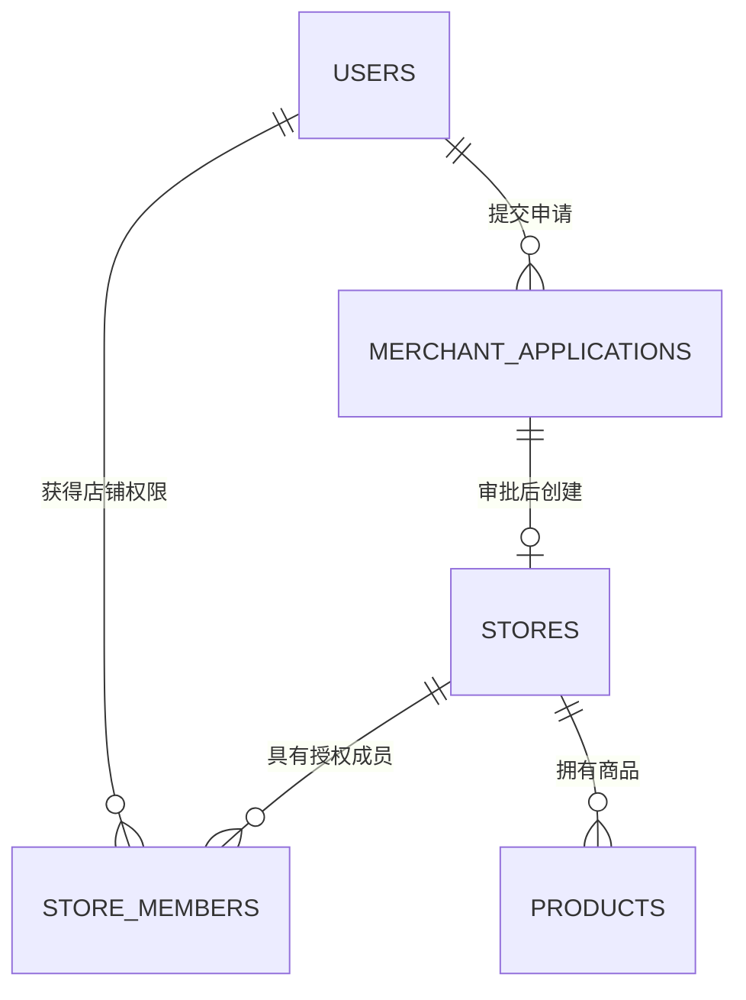
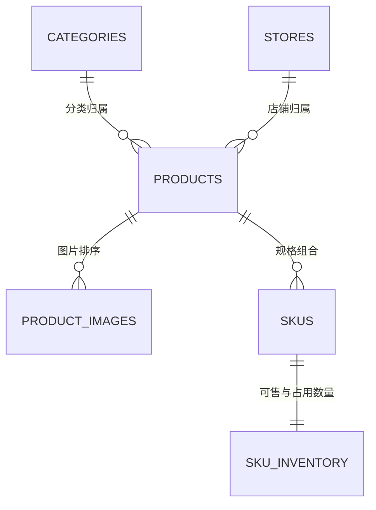
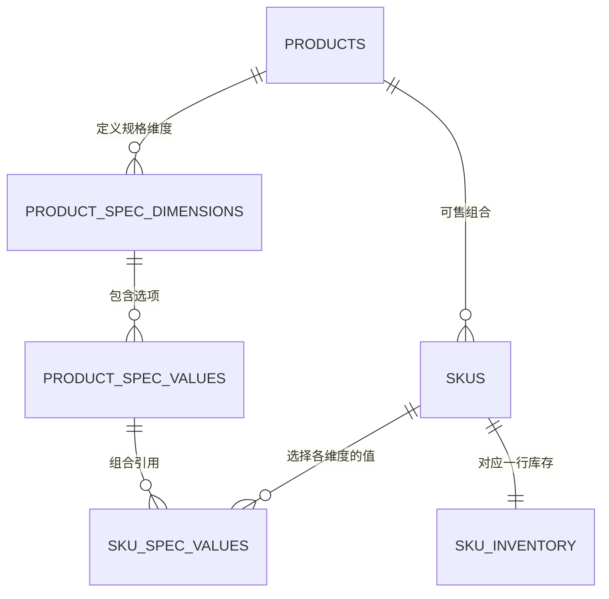
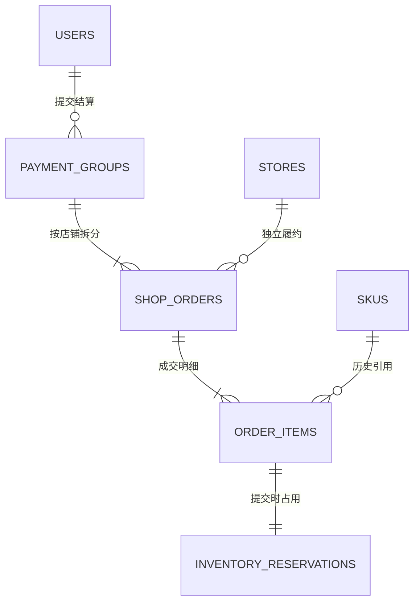

# 拾集 · 数据库设计讨论稿 v0.1

当前环境补充（2026-10-23，D072）：复用 Mac 已安装 MySQL / Redis，不再推进 D071 第二套容器数据库；项目账号认证与独立空库仍待配置。前端暂停，当前只准备环境连接。28 表候选、字段/索引/迁移与认证方案不因环境准备一次性冻结或建表。详见 [本地开发环境](17-本地开发环境.md)。

更新日期：2026-10-20  
状态：已确认数据库讨论先行（D050）、单店（D051）、管理登录（D052）、商品归属（D053）、主图与自动报价（D054）、编辑与状态规则（D055 / D057 / D058）、首版推荐（D059）。D060 增加商家选填展示价，D061 确认首版仅购物车商品项直接归用户、注册不初始化；D062 确认同组合新 SKU 再售/启用组合唯一、数量单项串行、素材回收及 401 当前内存输入保留。其余物理拆表/字段/参数及 P035 自填展示细节继续讨论；未生成 DDL、迁移或创建数据库。

## 1. 本轮讨论范围

先明确实体、关系、状态和关键约束，再细化字段类型、长度、索引及接口。以当前桌面原型和 [产品规划](01-产品规划.md) 为业务范围，不增加多店经营页面、员工管理、真实支付、售后或 Agent 数据表。

D072 当前复用本机 MySQL；此前 PostgreSQL 为历史建议。本稿仍是逻辑模型，具体 MySQL 字段、索引与迁移待工程接入逐项确定。Java 版与后续 Python 版复用规则和契约，迁移工具只由一个阶段的工程负责。

已存在的业务规则作为设计输入；下文新增的表结构、字段和约束方案均为讨论建议，不因写入本文自动成为用户确认事项。

2026-10-19 各模块候选表、字段及关系见 [结构复核稿](14-数据库结构复核.md)。P033 推荐的角色关联、商品八表与独立人工库存调整记录仍待确认；P034 购物车简化已由 D061 采纳，其他查询优化建议不自动视为同意。D060 新增商家选填展示价，P035 单列标签、校验及筛选排序细节。本稿不代表完整字段已冻结或执行建库。

用户要求最后核对后，当前以 [首版定稿评审清单 P036](14-数据库结构复核.md#10-首版定稿评审清单p036) 作为集中评审入口：5 个模块、28 张候选业务表，完整核对已确认规则、唯一性、归属、快照和事务；其余物理拆分待本版确认，MySQL 字段/索引随后细化，不生成第二套并列实现。

用户进一步要求重点查看字段和关联，已新增 [字段与关联字典 P037](15-数据库字段与关联字典.md)，逐表明确字段名及引用目标。用户关联购物车是由 `cart_items.user_id` 引用 `users.id` 实现，不在用户表保存购物车项 ID 集合；店铺、订单等同样区分直接外键、间接路径和快照。该稿细化同一份候选模型，不代表完整 SQL 已定。

## 2. 账号、经营主体和店铺

### 2.1 三个概念

| 概念 | 含义 | 当前项目处理建议 |
| --- | --- | --- |
| 用户账号 | 谁登录、谁购买或操作后台 | 统一 `users`；昵称头像属于账号 |
| 经营主体 | 店铺背后的个人或企业及其资质 | 当前保留申请资料，不增加完整企业、品牌、执照认证体系；如后续需要，再设计独立主体实体 |
| 店铺 | 商品和经营订单归属的业务空间 | 独立 `stores`，店名和 Logo 与用户资料分开 |

用户进一步询问淘宝、天猫如何处理多店。已核对 [淘宝开放平台：多店铺管理](https://developer.alibaba.com/docs/doc.htm?articleId=101129&docType=1&treeId=780)（文档标注更新于 2024-07-31，2026-10-18 查阅）：文档描述多个店铺接入同一管理系统，以及分别使用店铺账号授权获取商品、库存和订单。它能证明存在多店管理场景，不能直接推导一个普通登录账号或一个证件当下可开店的数量上限；本轮未取得最新开店配额规则的完整官方页面，不写入具体数量结论，也不推断淘宝内部数据库结构。

### 2.2 首版开店数量与扩展结构（D051 已确认）

2026-10-18 用户明确“可以的，就先限制一家，结构保留扩展空间”。首版一个账号最多拥有一家店，每家店一位店主；保留独立用户、店铺和店铺成员关系，当前不开放员工邀请或多店切换。

关联结构如下，物理字段和条件唯一约束实现随数据库产品确定，当前没有实际创建索引：

图表达可扩展的关联结构，首版额外限制一个用户至多有一条有效店主关系，每个店铺必须有一位店主。普通买家是账号基础能力，平台权限通过受控角色授予，商家权限来自具体店铺成员关系。

“同一账号既能购物又能卖货”沿用统一账号方案；“同一账号能拥有几家店”现已明确为首版最多一家。成员角色表示“在这家店的身份”，不影响该账号购物；平台管理员权限另行管理。

首版禁止同账号创建第二条有效店主关系；店铺停用仍保留店主归属，不通过停用绕过开店上限。以后若启用多店，除调整唯一约束和申请规则，还要补充店铺切换、上下文校验和回归检查，不能仅因结构可扩展就认为多店功能已完成。

建议以 `store_members` 中有效的 `OWNER` 关系作为店主归属依据，避免又在 `users.store_id` 或 `stores.owner_user_id` 维护第二份可独立变更的归属。后续若引入归属冗余字段，需另行说明权威来源和一致性保障。

### 2.3 第一组候选表

| 表 | 责任 | 关键字段候选 |
| --- | --- | --- |
| `users` | 登录与个人资料 | `id`、`login_name`、`password_hash`、`nickname`、`avatar_asset_id`、`status`、创建/更新时间 |
| `roles` / `user_roles` | 平台等受控角色与账号关联 | 角色编码、用户 ID、角色 ID；店铺归属仍由成员关系表达 |
| `merchant_applications` | 入驻申请当前资料及进度 | `id`、`applicant_user_id`、拟用店名/标识/分类/简介、`status`、`revision`、`submitted_at` |
| `merchant_application_records` | 提交与审核历史 | 申请 ID、版本、事件、操作者、时间、原因、对应提交资料快照 |
| `stores` | 通过审核后的店铺资料 | `id`、`application_id`、名称、Logo、简介、经营状态、平台限制原因、创建/更新时间 |
| `store_members` | 账号对某家店的权限 | `id`、`store_id`、`user_id`、成员角色、有效状态 |

关键约束建议：

- 登录名唯一，昵称可重复；账号密码只存哈希，管理员不能由公开注册获得。
- 成员关系 `(store_id, user_id)` 唯一；每店有效店主唯一，每用户有效店主关系至多一条。审批时并发校验并由数据库约束兜底，具体条件唯一约束随数据库产品确定。
- 只有审批通过才创建店铺，同一申请至多创建一家店；创建店铺、店主关系和更新审批结果在同一事务完成，重复审批返回已有结果。
- 待审核材料不能被悄悄改写；驳回后修改重提时增加版本，保留上次提交内容与审核原因。
- 店铺停用禁止新交易，仍按既有规则允许本人处理已有订单，不能直接删除成员或历史订单。

### 2.4 平台管理员与角色（方案建议，待确认）

建议管理员复用 `users` 的账号和认证机制，通过 `roles` / `user_roles` 获取平台权限；不建立另一套保存账号密码的 `admins` 表。管理员可使用专用后台账号，但该账号仍是 `users` 中独立的一行，普通注册不能自行取得角色。

用户已按 D052 确认管理登录流程：打开管理入口 → 共用登录页 → 输入账号密码 → 后端检查管理员角色 → 进入管理台。已有有效登录态则直接检查权限，无权限时不进入；管理员的具体角色表字段与认证会话技术仍待设计。平台管理与商家工作台分别有业务页面，前端入口不授予权限。具体流程与公开参考见 [登录与账号细节](07-登录与账号细节.md)。不因此新建另一套管理员账号密码表或复制登录界面。

| 表 | 关键字段候选 | 约束和责任 |
| --- | --- | --- |
| `roles` | `id`、`code`、`name`、`status` | 编码唯一；首版可先配置 `PLATFORM_ADMIN`，不提前铺设多级管理员体系 |
| `user_roles` | `user_id`、`role_id`、`granted_at`、受控授予来源/操作者 | 用户角色组合唯一；授予、撤销由受控流程执行，不通过公开注册或个人资料接口修改 |
| `merchant_application_records` | `actor_user_id`、申请及提交版本、动作、结果、原因、时间 | 入驻审批的审核历史 |
| `platform_action_records` | `actor_user_id`、目标类型/ID、动作、原因、时间 | 商品限制、店铺停用及解除的管理历史 |

`PLATFORM_ADMIN` 是平台范围角色；`store_members.role = OWNER` 是限定具体店铺的角色，两者不混用。不要将用户的全部身份压成只能单选买家/卖家/管理员的 `user_type` 字段。

实际执行审批、下架或停用时，要检查账号和角色当前有效、是否具有对应动作权限，并记录实际操作者。界面是否显示入口不构成授权。首版权限动作可由后端固定映射；可配置的权限表、角色权限关联和授权管理页面在出现具体需求后另议，本轮不新增这些产品功能。

## 3. 商品与规格

### 已确认的归属规则（D053）

2026-10-19 用户认可此前归属规则并要求后续遵守：

- 商品属于一家店铺，同型号在不同店铺售卖时分别有自己的商品 ID。
- SKU 属于具体商品；价格及库存按 SKU 管理，库存记录关联 SKU。
- 购物车商品项和订单明细引用 SKU ID，成交订单另外保存历史快照。
- 无规格商品也具有一个默认 SKU，金额按整数分存储。

以上是后续字段、接口和资源权限的约束；认可归属关系不等于确认八类候选表的全部物理拆分、字段或发布细节。

### 3.1 关系与分工

一款“无线键盘”为商品；“米白色 / 有线版”和“深灰色 / 无线版”为具体 SKU。商品保存共享介绍和图片，SKU 保存可购买组合及价格，库存按 SKU 管理。无规格商品也建立默认 SKU。

| 表 | 责任 | 关键字段候选 |
| --- | --- | --- |
| `categories` | 商城分类 | ID、父分类 ID、名称、排序、启用状态 |
| `products` | 一款商品的共享资料 | ID、店铺 ID、分类 ID、标题、介绍、事实参数、可选商家展示价、销售状态、平台限制、上架时间 |
| `product_images` | 商品图及主图顺序 | ID、商品 ID、素材 ID、排序；按 D054 由商家将主图排在首位，不再保存独立可冲突的主图标记 |
| `skus` | 实际购买规格及价格 | ID、商品 ID、规格组合、组合唯一键、价格分、启用状态 |
| `sku_inventory` | 规格库存 | SKU ID、`available_stock`、`reserved_stock`、更新时间 |

首版已规划最多两个规格维度。维度、可选值及 SKU 组合的物理拆法尚未选择；本轮 P028 进一步建议使用下文的独立规格表与关联表，保留结构化字段作为未采用的备选，不同时维护两套可变规格定义。

规格应有稳定标识，不能用展示文字拼接作为唯一身份；按 D062，同一商品同时启用的完整规格组合不能重复，历史停用 SKU 可保留相同组合。组合必须属于该商品定义的维度/选项；再次销售相同退役组合创建新 SKU ID，旧 SKU 继续停用，旧购物车不改绑。SKU 停用或规格文案变化不能改写订单快照，关联历史订单后不物理删除。

金额使用整数分。D060 更新 D054：商家可选填商品展示价，未填时沿用有货优先的 SKU 最低价作为自动展示价；SKU 仍是实际售价来源，详见 3.6。自填价的标签、筛选与排序规则列为 P035 待确认，是否缓存派生报价在查询实现时评估。

商品自主上下架与平台限制分开表达，防止商家重新上架绕过平台处理。公开查询同时核对店铺正常、商品在售和平台限制，沿用 [查询契约草案](11-Agent接口预留.md)。

### 3.2 商品表关键字段建议

本轮用户询问商品表，先补逻辑字段，尚未确定 SQL 类型、长度或规格物理拆法：

| 表 | 关键字段示例 | 设计目的 |
| --- | --- | --- |
| `products` | `id`、`store_id`、`category_id`、`title`、`description`、事实参数、`sale_status`、平台限制、`published_at`、创建/更新时间 | 存放同款商品共享内容；商品属于一家店铺，创建/修改时核对店铺权限 |
| `skus` | `id`、`product_id`、稳定规格选项组合、`spec_key`、`price`、`status`、创建/更新时间 | 存放实际购买规格；price 为整数分，同商品启用完整组合唯一，停用历史可多代同组合 |
| `sku_inventory` | `sku_id`、`available_stock`、`reserved_stock`、更新时间 | SKU ID 作为主键和外键，确保一个 SKU 对应一行库存；可售/占用非负 |
| `product_images` | `id`、`product_id`、`asset_id`、`sort_order` | 按顺序返回多张图；主图取排序首图，素材元数据由图片能力管理 |
| `categories` | `id`、`parent_id`、`name`、`sort_order`、`status` | 分类可关联多款商品，父分类为空时为根分类 |

示例：同一“无线键盘”商品下可以有米白色有线版和深灰色无线版两个 SKU，分别具有 12900 分 / 15900 分的价格，以及不同的可售和占用数量。示例用于解释归属，不修改现有演示商品数据。

商品表不重复管理实际 SKU 售价/库存；D060 允许单独选填展示价，未填时按 D054 从有货的有效启用 SKU 自动计算，全售罄仍明确参考状态。订单和购物车引用 SKU ID，订单另保留成交快照。商家调整共享标题或图片不需要复制整款商品，调整某规格价格也不会改变另一规格。

`store_id`、商品归属及 SKU 归属必须由服务端核验；不能通过伪造字段修改其他店铺商品。商家销售状态和平台限制分别保存，管理员处理要记录原因和操作者。具体规格维度/值表及更细字段继续逐项讨论，不在本轮提前冻结。

### 3.3 本轮进一步讨论：规格维度、选项与组合（P028，待确认）

建议先明确：这里 `products` 表示“某家店铺发布的一款商品”。即使两个店铺卖同型号，也分别有自己的商品 ID；首版不额外建立跨店统一标准商品库。

以一款键盘为例：

| 层次 | 示例 | 数据责任 |
| --- | --- | --- |
| 商品 | K87 键盘 | 标题、所属店铺、分类、共享介绍和图集 |
| 规格维度 | 颜色、连接方式 | 商家在当前商品下定义的可选维度，首版最多两个 |
| 规格选项 | 米白、深灰；有线、无线 | 属于对应维度的稳定选项 |
| SKU | 米白 + 有线 | 可购买的具体组合，具有自己的价格和库存 |

如果四种组合都实际售卖，就有四个 SKU；不售卖的组合不必创建。无规格商品沿用一个默认 SKU，购物车与订单仍引用 SKU ID。

建议在已有五类候选表基础上补充三张规格关系表：

| 候选表 | 关键字段 | 约束建议 |
| --- | --- | --- |
| `product_spec_dimensions` | `id`、`product_id`、`name`、`sort_order` | 每个维度属于一款商品；同商品维度名规范化后不重复，最多两个由服务端事务内校验 |
| `product_spec_values` | `id`、`dimension_id`、`value`、`sort_order` | 每个选项属于一个维度；同维度选项规范化后不重复 |
| `sku_spec_values` | `sku_id`、`dimension_id`、`value_id` | 同一 SKU 每个维度至多选择一个值；选项必须属于该维度，且维度所属商品必须与 SKU 一致 |

共八类商品候选表为 `categories`、`products`、`product_images`、`product_spec_dimensions`、`product_spec_values`、`skus`、`sku_spec_values`、`sku_inventory`。图片素材元数据继续由共享素材能力管理，表数不是最终建库承诺。

`skus.spec_key` 由稳定维度 ID / 选项 ID 按固定 ID 顺序生成规范组合键，服务端与 `sku_spec_values` 同一事务维护，客户端不能直接编辑。D062 更新原无条件唯一建议：只保障同商品同时启用的完整组合唯一，允许停用历史多代使用同一 spec_key。不能用无条件 (product_id,spec_key) 或 (product_id,spec_key,status) 唯一键阻止保留多条相同停用历史；条件唯一约束的 SQL 形式随数据库选型确定。展示名称、展示排序变化不改变组合身份。无规格默认 SKU 的固定空组合键也遵守启用唯一，未完成草稿的组合编码/可空校验随详细设计确定。

按 D057，已发布 SKU 替换为不同规格组合时，保留并停用旧 SKU，为新组合创建新 SKU，由同一次保存一致完成；旧组合停止销售，原购物车不改绑新组合。旧 SKU 的原组合含义及必要关联须保留，不能通过覆盖选项含义让旧引用变成新规格。更新价格、库存和不改变实物含义的名称修正不必更换 SKU 身份。关联购物车或历史订单的 SKU 不物理删除，订单继续使用成交快照；具体字段、事务约束及选项留存的物理实现随详细设计细化。

### 三张规格关系表的逐行示例（P028 讨论细化）

本轮将“这三张表”先按上一轮新增的规格维度、规格选项和 SKU 选项关联展开；商品主体、SKU 和库存三张核心表的职责保持为“共享资料 / 购买组合与价格 / 库存数量”。以下全部为虚构行示例，不是执行结果或实际种子数据。

设商品 `1001` 为 K87 键盘。

**`product_spec_dimensions`：这款商品可以按哪些维度选择。**

| id | product_id | name | sort_order |
| --- | --- | --- | --- |
| 10 | 1001 | 颜色 | 1 |
| 20 | 1001 | 连接方式 | 2 |

`id` 是维度标识，`product_id` 限定所属商品，`name` 是界面标签，`sort_order` 是展示顺序。另一款商品若也有颜色，在当前候选方案下定义属于它自己的维度记录；首版不先建立跨商品规格模板。

**`product_spec_values`：每个维度有哪些可选值。**

| id | dimension_id | value | sort_order |
| --- | --- | --- | --- |
| 11 | 10 | 米白 | 1 |
| 12 | 10 | 深灰 | 2 |
| 21 | 20 | 有线 | 1 |
| 22 | 20 | 无线 | 2 |

`dimension_id` 将选项归到维度。米白和深灰是颜色选项，有线和无线是连接方式选项；本表不保存 SKU 售价或库存。

**`sku_spec_values`：某个 SKU 具体选择了哪些值。**

| sku_id | dimension_id | value_id |
| --- | --- | --- |
| 101 | 10 | 11 |
| 101 | 20 | 21 |
| 102 | 10 | 11 |
| 102 | 20 | 22 |

SKU 101 的两行共同表示“米白 + 有线”，SKU 102 的两行共同表示“米白 + 无线”。关联表一行表示一个维度的选择，不是一行完整商品或一个独立购买单位。

SKU 101 / 102 仍需分别在 `skus` 里有商品 1001 的主记录及整数分价格，并在 `sku_inventory` 各有一行可售/占用库存；关联表不重复保存价格、库存、标题或店铺归属。

校验建议：同 SKU 同维度只能选一个值；值必须属于该维度；维度所属商品必须与 SKU 商品相同；发布时需覆盖该商品所有有效规格维度；同商品启用的完整组合不得重复，停用历史允许多代同组合（D062）。示例中的冗余 dimension_id 应与选项归属一起校验，不能允许“颜色维度选中无线”。有明确组合的 SKU 才表示可售组合，单纯新增规格选项不会自动生成可购买 SKU。

买家选中米白、无线后，页面/查询根据维度及选项 ID 找到 SKU 102，再读取其当前价格和库存。名称和顺序用于展示，选项 ID 与 SKU ID 用于身份；后续提交购物车或订单传 SKU ID，服务端重新校验。无规格默认 SKU 可以没有这些规格关联行，不需要伪造“颜色=默认”。

### 3.4 草稿、图片与状态（D055 行为已确认，P028 物理字段待确认）

建议商品主表的共享字段包括 `id`、`store_id`、`category_id`、`title`、`description`、事实参数、`sale_status`、平台限制及原因、`published_at`、创建/更新时间；不把单一价格或总库存作为另一套可独立编辑的来源。所属店铺由登录上下文及成员权限确认；创建人如需留痕可单独记录，不替代店铺归属。

按 D055，商品草稿允许资料不完整。保存成功后，应持久化已填写内容；商家后续打开同一草稿时回显已保存的文本、图片及顺序、已填写的规格与价格/库存，继续补充并更新同一个商品 ID，不因再次保存或发布而重复创建商品。读取和修改均核验店铺权限，草稿不进入公开商品查询。未点击保存的临时输入不因此承诺自动恢复，本轮没有增加自动保存。

草稿与正式发布的要求区分：正式发布至少具备有效分类、标题、商品主图和有效 SKU；价格为正、规格完整和库存非负仍需校验，零库存可显示售罄而不能购买。草稿允许空的具体字段、素材引用有效性、数量/长度上限及 SQL 约束在字段字典阶段细化，不为保存草稿伪造零元售价。草稿保存/加载/发布接口及实际持久化尚未实现。

价格仍使用整数分；可售数量与占用数量按 SKU 分开。前端展示报价按 D060 先取商家选填值，自动分支按 D054 执行有货优先及全售罄回退规则，售罄不等于下架；商品状态 `DRAFT / ON_SALE / OFF_SALE`、SKU 启停和平台限制各司其职。按 D055，首次成功发布由服务端写入 `published_at`；未发布的草稿没有发布时间。修改标题/价格以及重新上架不重置该时间，“最新上架”按首次发布时间倒序，同时间使用稳定 ID 次级排序。创建、更新与首次发布的时间语义分开，字段类型仍待确定。

购买规格与普通商品参数分开处理：颜色、连接方式影响 SKU 选择；材质、保修说明等非购买选项可先保存为受校验的键值参数，不为每个展示参数都创建 SKU。本轮不增加按参数筛选或复杂属性管理页面。

商品图片继续按商品归属、素材 ID 和顺序保存；排序第一张作为主图，图集随详情查询返回。按 D055，每个 SKU 可选地关联一张当前商品图片，未绑定或引用失效时回退商品主图；服务端核验图片与 SKU 属于同一商品，不允许借用其他店铺或商品的私有素材。多个 SKU 可以使用同一张商品图，不新增独立 SKU 图集或图片管理页面。关联字段、移除图片时引用清理的具体实现待详细设计；详情默认选中哪个 SKU 尚未选择。

商品归属按 D053、主图和展示报价按 D060 更新 D054、草稿回显及可选 SKU 图片等行为按 D055、SKU 替换保存与旧车失效按 D057 已确认；规格表拆分、发布校验字段约束及详情默认选择仍待讨论。当前只维护设计与查询契约草案，Demo、实际商品接口和数据库均未修改。

### 3.5 商家发布多种样式怎样复用表（P028 说明细化）

用户询问发布多种样式时能否复用上述表。候选模型本来就用于普通商家的商品发布、编辑与买家查询：所有商家共用同一套表结构，通过店铺、商品、SKU 等 ID 区分各自记录；不为商家、新商品或每种样式动态创建物理表。

同一款 T 恤有红/白两色、M/L 两个尺码，且四种组合均售卖，首次建立完整配置时可有以下业务记录：

| 共享表 | 该商品的记录数示例 | 含义 |
| --- | --- | --- |
| `products` | 1 | 一款 T 恤，归属当前店铺 |
| `product_spec_dimensions` | 2 | 颜色、尺码 |
| `product_spec_values` | 4 | 红、白、M、L，分别归属对应维度 |
| `skus` | 4 | 红 M、红 L、白 M、白 L |
| `sku_spec_values` | 8 | 每个 SKU 分别关联一种颜色和一个尺码 |
| `sku_inventory` | 4 | 四个 SKU 各自的可售/占用库存 |
| `product_images` | 按实际图片数 | 当前商品的共享图集 |

SKU 价格保存在各自 `skus` 记录中。共用表结构不表示共用其他商家的商品、规格定义、价格或库存；即使两个商品都叫“红色”，当前候选方案的选项仍分别归属各自商品维度，不能修改一处影响其他商品。

不同款式如果需要作为独立商品展示，例如另一型号键盘或另一款台灯，在同一张 `products` 增加新记录，再建立它自己的规格和 SKU；仍不新增物理表。如何拆成独立商品按实际售卖方式判断，不仅凭颜色名称决定。

上表示例说明新商品的最终记录规模，不表示每次点击发布都新增同一批记录。已有草稿应更新已有商品及关联配置，再转换销售状态；重复提交要避免重复商品或重复 SKU。数据库记录的创建/更新按归属和组合规则统一校验，必要的关联写入在同一事务内完成；图片素材上传不作为长时间持锁事务的一部分。具体保存/发布接口仍待设计。

### 3.6 首页卡片图片与展示价格（D060 更新 D054）

D060 已确认：商家可以选填商品展示价；填写时优先展示该值，未填写时系统采用商品 SKU 的最低价。用户未要求取消此前的有货优先规则，自动分支继续沿用 D054 的候选范围。此条替换 D054 中“不允许独立填写展示价”的限制，主图来源不变。展示价不替代所选 SKU 的实际售价、购物车金额或订单成交快照（D053）。

图片采用排序首图方案：`product_images.sort_order` 最靠前的图作为主图，商家选择主图等价于调整图片排序。无需同时维护另一份可独立修改的主图字段。列表接口可返回派生的 `cover_image` 字段，图片存储引用仍来自可信素材记录；字段类型及图片排序约束在字段字典中细化。主图描述整款商品，D055 另外确认了详情可选的 SKU 图片绑定，不改变列表主图来源；若主图只表现某个高配规格，文案和规格说明应避免让用户误以为起价必然对应该配置。

未填写商家展示价时，自动汇总方式仍为：

1. 先核对店铺正常、商品在售、无平台限制，只纳入启用且具有有效正数售价的 SKU。
2. 至少一个 SKU 可售库存大于零时，从有库存的候选 SKU 计算最低/最高价；只有一个价格时直接显示该价，存在多个价格时显示最低价并标“起”。不按用户购买数量承诺占用库存。
3. 全部有效启用 SKU 均售罄时，仍可按既有范围展示商品；最低/最高报价回退为这些 SKU 的参考价范围，并明确“已售罄”，禁用加购/购买。该报价不能描述为当前可购买价格。
4. 没有有效启用 SKU 时不进入正常可购买货架，管理端提示完善配置；具体错误码及存量异常处理在发布/查询接口中细化。

示例：

| 规格 | 实际售价 | 可售库存 |
| --- | --- | --- |
| 米白有线版 | 12900 分 | 0 |
| 米白无线版 | 15900 分 | 8 |
| 深灰无线版 | 17900 分 | 6 |

该示例在未填写展示价时，首页显示商家指定主图及“¥159 起”；不以没有库存的 ¥129 作为自动起价。若商家填写展示价，则优先使用填写值，不能把它默认为 SKU 最低价。详情按所选 SKU 展示实际价格和库存。首次进入详情是否默认选中有货起价 SKU 仍待讨论；已有明确规格上下文时仍需重新核验可售性。

候选字段分工（名字和 SQL 类型待定，金额沿用整数分）：

| 候选字段 | 责任 |
| --- | --- |
| `products.display_price_override` | 商家选填的商品展示价，允许为空；清空后恢复自动计算，不把空值默认为零元 |
| `display_price` | 查询返回的最终展示价：有填写值时优先取填写值，否则取自动最低价 |
| `display_price_source` | 查询标明来源，例如 `MERCHANT` / `AUTO`，避免将自填价误认为实际最低价 |
| `min_price` / `max_price` | 仍表示 D054 候选 SKU 范围内的实际最低/最高价，不被自填展示价覆盖 |
| `cover_image` / `stock_status` | 商家主图与真实库存状态；填写展示价不能把售罄或无有效 SKU 变成可购买 |

商家原始填写值与系统派生起价属于不同数据，不共用一个可被后台计算覆盖的字段。缓存时需同时覆盖商家展示价修改/清空、SKU 改价/启停、库存占用/释放/补货和商品状态变化；详情与提交结算仍重新核验实际 SKU。

D054 曾取代未区分库存的最低价草案；现由 D060 增加商家优先的选填分支。[查询契约草案](11-Agent接口预留.md) 已同步区分展示价和实际 SKU 范围。本轮仅确认设计，没有修改 Demo、实际 API、数据库或执行工程验收。

P035 待确认细节：建议首页与店铺的价格筛选/排序统一使用最终 `display_price`，并在最终分页前完成过滤和排序；自填价不自动标为“起”，具体标签及与实际 SKU 范围的差异提示另定。是否要求自填价对应某个实际 SKU、是否限制其与实际价格的差距，也尚未确认，不擅自禁止低于/高于实际 SKU 范围的填写。这里只区分已确认的选填规则与后续校验/展示建议，不增加新的优惠或促销能力。

### 3.7 商品模块边界确认与剩余讨论（P031，D055 / D057）

用户按 D055 采纳原第 1、3、4、5 项，并要求第 1 项明确已保存内容回显。第 2 项现按 D057 确认：替换后旧 SKU 保留并停用，新组合创建新 SKU；旧购物车显示“所选商品不能购买”，商品缩略图/图标变灰，点击进入原店铺。库存为零仍显示“已售罄”。这取代 D056 曾将替换停售也显示为已售罄的临时口径；保存方案不再待确认，具体物理字段及详情默认 SKU 仍待细化。

| 事项 | 当前规则与状态 | 对字段与约束的影响 |
| --- | --- | --- |
| 草稿与发布条件 | D055 已确认：允许不完整草稿，保存后再次打开回显已存内容并继续补充；正式发布要求有效分类、标题、主图及有效 SKU | 同一草稿身份、服务端持久化与归属校验；可空字段和长度/数量限制继续细化 |
| 已发布 SKU 的修改 | D057 已确认：替换白色 M 后停用并保留旧 SKU，为黑色 L 创建新 SKU；旧购物车显示所选商品不能购买、商品图变灰，点击进入原店铺 | 同一次保存保持一致，原购物车继续引用旧 SKU，禁选/禁结算且不自动换成新组合；普通改价/补库存不更换身份 |
| SKU 图片 | D055 已确认：每个 SKU 可选关联一张当前商品图，未绑定或失效时回退主图 | 同商品归属校验；可选关联字段与移除图片时的处理待详细设计 |
| 详情默认选择 | 待确认：默认选中有货起价 SKU 或要求主动选择尚未决定 | 保留已有规格上下文并核验可售性，不在本轮修改默认选择 |
| 库存修改与并发留痕 | D055 已确认：防止旧表单覆盖新库存，记录调整前后数量、原因、操作者和时间；沿用可售/占用分离 | 冲突检测方式和记录表物理结构继续细化，不增加库存管理页面 |
| “最新上架”的时间 | D055 已确认：首次成功发布写入 `published_at`，标题/价格修改及重新上架不重置 | 区分创建、更新、首次发布时间；上新排序按首次发布时间 |

第 2 项按“替换”执行：同一件 T 恤下，SKU 101 原本代表白色 M，买家已加入购物车；商家改为卖黑色 L 后，白色 M 停止销售。旧购物车保留白色 M，显示“所选商品不能购买”，商品缩略图/图标变灰，不可勾选参与结算。点击该失效商品的图片或标题进入原店铺，店铺归属不因更换 SKU 而改变；商品图变灰不应禁用店铺导航入口。这里只确认原店铺仍可访问的场景，店铺停用时继续遵守公开可见性规则，不绕过权限限制。

已确认的内部保存方案：保存时把 101 停用，给黑色 L 建立 SKU 102，两步保持一致；后台留存 101 和原组合含义，用于识别旧购物车与历史引用。新规格使用自己的库存，原购物车不自动改绑 102。商家一次保存完成替换，界面不要求自行管理新旧数据库记录或分别发布两次。具体关联字段、写入顺序和事务实现仍待字段字典与接口设计，不表示当前已实现。

修改 101 的价格、库存或不改变实物含义的名称修正不需要新增 SKU。历史订单继续使用 D053 已确认的成交快照，不能把订单会被改写作为本建议的前提；这里主要避免旧购物车和其他当前 SKU 引用被换成另一种规格。

按 D057 区分两种状态：仍启用但可售库存为零的规格显示“已售罄”；被替换而停用的规格显示“所选商品不能购买”，配灰图和原店铺入口。停用 SKU 不因新规格补库存而自动恢复可购买。公开 SKU 批量查询仍将停用项视为 `NOT_AVAILABLE`；原店铺入口由可信归属生成，不放宽公开商品可见性。购物车以已认证用户的原选择显示失效信息，具体私有响应字段在后续购物车设计中细化。

草稿回显、可选 SKU 图片、库存人工调整记录、首次发布时间、SKU 替换保存与旧购物车失效交互均为正式工程目标。本轮只更新文档与查询契约，没有修改 Demo 或实际服务。后续形成商品字段字典，完整购物车和管理员角色物理结构按原顺序讨论，不因本轮交互确认而提前冻结全部购物车表结构。

### 3.8 商家下架与推荐设计（D058 / D059，已确认）

D058 确认商家自主下架整款商品后的行为：购物车显示“商品已下架”，不能勾选结算；点击该商品进入下架状态页，上方显示商品已下架，下方显示其他商品推荐。此路径区别于 D057 的“原规格被替换后点击进入原店铺”，不能把所有不可购买情况都跳转到同一个地方。

商家下架使用商品销售状态，不删除商品、SKU 或店铺归属；下架不等于清零库存，也不改写历史订单。若商品同时下架且原 SKU 已停用，对这次购物车点击优先表达商品已下架并进入下架状态页；平台限制、店铺停用与从未公开的草稿继续按各自可见性规则处理。

原公开详情草案把所有不可见项统一为 404，现为 D058 的商家自主下架场景保留最小状态响应：仅适用于曾公开发布、店铺正常且无平台限制的商品，返回下架状态和允许公开的店铺标识；不返回可购买 SKU、当前价格/库存、内部下架原因或管理资料。其余不可见项仍统一 404。具体响应草案见 [查询契约](11-Agent接口预留.md)，推荐列表使用独立的公开在售商品卡片，不把下架商品重新放回搜索货架。

用户已按 D059 采纳 P032 的首版策略：规则推荐为主、相近候选少量稳定轮换；首页在现有商品流内兼顾新品、人工精选和分类/店铺多样性，下架页优先同类近价、本店优先再全站补齐。用户喜好推荐留到行为数据积累后的阶段，不纳入当前实现。此确认不冻结具体权重、近价阈值、展示数量或推荐接口字段：

| 场景 / 阶段 | 已确认策略 / 后续方向 | 当前边界 |
| --- | --- | --- |
| 首版首页 | D059：人工精选、新品和不同分类混合，适当打散店铺；相关性相近候选少量稳定轮换 | 使用当前商品数据即可，无真实统计时不展示热销/猜你喜欢或虚构个性化；不新增首页楼层/运营配置页面 |
| 下架页替代商品 | D059：原商品同分类、价格接近的可买商品优先；先本店，候选不足再由全站同类补齐，仍不足时少展示 | 原分类/参考报价仅作服务端内部上下文；排除原商品、下架/受限/停用店铺及无可售库存候选，不重复凑数 |
| 行为积累后的轻量个性化 | 后续方向：浏览、搜索、加购和实际购买形成近期分类/价格偏好，同时保留新品和其他分类 | 当前不实施；采集范围、窗口、权重、去重、保存周期和身份另行设计，未创建行为/喜好表 |
| 后续更复杂算法 | 候选：数据足够且规则方案确有不足时，再评估更细商品特征相似度或协同过滤等方法 | 具体算法未选，不纳入首版，不引入训练服务、向量库或 Agent；不承诺未验证的准确率 |

推荐候选资格和价格复用商城规则：正常店铺、在售商品、无平台限制、至少一个有效启用且有可售库存的 SKU；卡片展示价按 D060 计算，近价匹配对自填值的处理随 P035 细化。普通货架仍可显示售罄参考价，推荐候选则筛选当下有货的商品；推荐不改变结算时再次核验价格和库存的规则。

随机仅用于相关性相近候选的少量轮换；同次浏览/分页保持稳定顺序，返回详情后保留结果，不对每页独立随机导致重复和漏项。具体种子/结果集实现尚待工程设计。用户明确选择价格升降序或上新排序时遵守其排序，推荐混排不覆盖用户意图。当前每页 12 件不变，本轮不实现无限滚动。

现有商品分类、店铺、发布时间、SKU 价格和库存可支撑首版规则候选查询；D059 已确认策略，查询参数、推荐响应、索引与缓存随字段字典和接口设计细化。当前不增加喜好表、行为日志表、独立推荐服务或容器，也不开发 Agent。本轮仅更新设计与验收目标，未调整 Demo、实际 API 或数据库。

方法参考：[Google 推荐系统概述](https://developers.google.com/machine-learning/recommendation/overview/types) 将推荐组织为候选生成、评分和重排；[候选生成说明](https://developers.google.com/machine-learning/recommendation/overview/candidate-generation) 区分内容相似与协同过滤。以上仅用于概念参考，同店优先、价格接近及首版取舍是本项目按 D059 采纳的策略，并非来源规定的固定规则。

## 4. 购物车与地址

| 表 | 责任 | 关键字段候选 |
| --- | --- | --- |
| `cart_items` | 用户准备购买的 SKU | ID、用户 ID、SKU ID、数量、创建/更新时间 |
| `user_addresses` | 当前地址簿 | ID、用户 ID、收件人、电话、省市区及详细地址、默认标记、创建/更新时间 |

`(user_id, sku_id)` 唯一，再次加购合并数量；价格、库存和店铺通过当前 SKU 关联查询。购物车中的旧价格不构成成交报价，结算时重新计算；商品不再可售时保留失效提示。D057 明确：库存为零按已售罄处理；规格被替换而停用时，原购物车项显示“所选商品不能购买”，商品缩略图/图标变灰，不能勾选结算，点击图片/标题仍进入原店铺。原购物车继续引用保留的旧 SKU，不自动替换为新 SKU；具体私有响应及物理字段继续设计。

D058 补充整款商品被商家下架：购物车显示“商品已下架”，点击进入商品下架状态页，并在下方展示其他商品推荐；与 D057 的规格替换失效和普通库存售罄分别表达。推荐按 D059 的同类近价、本店优先及全站补齐执行，具体参数另行细化；购物车归属现由 D061 确认，不新增推荐表。

### 注册与空购物车（D061，更新 P029 / P034）

用户提出购物车及类似数据应在注册后直接创建。需要区分数据库结构与用户业务记录：表结构在工程初始化/版本迁移时统一创建；用户注册只在共享表内新增该用户的记录，不为每个账号动态创建 `cart_用户ID`、地址表或订单表。

用户已按 D061 采纳仅保留共享 `cart_items` 的方案，商品项直接通过 `user_id` 归属账号，首版不建 `carts` 主表。没有商品项就返回空购物车，注册无需插入任何购物车记录；首次加购才新增商品项，同一用户同一 SKU 合并数量。按 SKU → 商品 → 店铺分组展示，价格与可售状态按实际 SKU 读取。

该选择取代 P033 的显式主表推荐及 P034 的待确认状态，见 [结构复核](14-数据库结构复核.md)。将来若出现独立购物车级业务状态，再提出新需求评估主表，不把它保留为首版未决选项。详细 SQL 类型、索引及私有接口仍待细化，当前未生成迁移。

注册不预填购物车商品项、收货地址、订单、支付单或开店申请；这些记录在加购、填写地址、提交结算和申请开店等实际动作发生时创建。不为新账号伪造地址、空订单、未申请店铺或管理员角色。

购物车勾选、排序、浏览位置和工具栏收放是否跨设备保存是独立需求，当前不为了原型瞬时状态增加业务表；勾选首版可先作为结算请求上下文。删除撤销对应重新加回商品，需要重新校验当前状态。

地址必须属于当前用户；D064 确认没有任何地址时，新增首条由后端自动设为默认，后续新增仅显式设为默认才切换原默认。同用户至多一个默认地址，数据库保障方式待选型后细化。编辑、删除地址簿不能影响旧订单。订单实际收货信息另存快照，不只关联一个可修改的地址 ID。

## 5. 支付、店铺订单与明细

| 表 | 责任 | 关键字段候选 |
| --- | --- | --- |
| `payment_groups` | 一次统一付款 | ID、支付单号、买家 ID、总金额分、币种、支付状态、截止/支付/关闭时间、关闭原因 |
| `shop_orders` | 一家店的订单与履约 | ID、订单号、支付单 ID、店铺 ID、订单状态、金额、收货地址及店铺名称快照、演示物流、发货/收货时间 |
| `order_items` | 每个 SKU 的成交记录 | ID、店铺订单 ID、商品/SKU ID、标题/图片/规格快照、成交单价分、数量、行金额 |
| `inventory_reservations` | 每条明细的库存占用结果 | ID、订单明细 ID、SKU ID、数量、占用/确认/释放状态及时间 |
| `payment_events` | 模拟支付事件去重与结果 | 事件唯一键、支付单 ID、结果、处理时间 |
| `idempotency_records` | 写操作重试防重 | 调用者、操作范围、幂等键、请求摘要、处理状态、关联结果 |

一次买 A 店键盘和 B 店台灯：生成一个支付单、两个店铺订单、各自明细；付款统一完成，发货与收货分别推进。支付单没有“统一已发货”状态。

约束建议：同一支付单同一店铺仅一笔店铺订单；同一订单明细至多一笔占用记录；行金额等于成交单价乘数量，订单金额为明细之和，支付总额为关联订单之和。服务端统一计算并在提交事务内校验；跨行汇总不能只靠单列 CHECK 约束。

同次结算使用同一地址，但每个店铺订单保存所需收货快照，保持独立履约资料。首版整单一次发货，物流字段可先保存在店铺订单；多包裹和部分发货尚不纳入。

## 6. 库存和状态怎样配合

以某 SKU 初始可售 10 件、占用 0 件，用户下单 2 件为例：

| 操作 | 可售库存 | 占用库存 | 占用记录 |
| --- | --- | --- | --- |
| 结算预览 | 10 | 0 | 不创建 |
| 提交成功 | 8 | 2 | `RESERVED` |
| 成功付款 | 8 | 0 | `CONFIRMED` |
| 或未付款关闭 | 10 | 0 | `RELEASED` |

“付款”和“未付款关闭”是互斥后续分支；重复处理不能再次扣减或释放。可售和占用均不得为负；用库存条件原子更新或行锁控制并发，不能先查再无条件扣减。商家改库存只调整可售部分，沿用同一并发规则。

D055 确认库存人工调整要保存调整前/后可售数量、原因、操作者和时间；数量更新与相应记录应保持一致，失败不能只保存一半。服务端还需识别旧编辑数据与当前库存冲突，不能让旧表单无条件覆盖期间发生的下单或其他调整。最终采用版本条件、差量操作或其他冲突控制方式，以及变更记录的物理表结构，在详细设计时确定；本轮没有创建库存流水表或实现库存接口。

提交结算以一次事务创建支付单、店铺订单、快照和占用，任何 SKU 失败则整次回滚。付款与关闭按同一锁顺序争用支付单，只有合法状态转换能提交；唯一事件及幂等记录限制重复效果。

状态输入沿用已规划业务，英文值为建议编码：

| 对象 | 状态 |
| --- | --- |
| 申请 | `DRAFT → PENDING → APPROVED / REJECTED`；驳回后可修改重提 |
| 店铺 | `ACTIVE / DISABLED` |
| 商品销售状态 | `DRAFT / ON_SALE / OFF_SALE`；平台限制另存 |
| 支付单 | `PENDING → PAID / CLOSED` |
| 店铺订单 | `PENDING_PAYMENT → PENDING_SHIPMENT → PENDING_RECEIPT → COMPLETED`；待付款可关闭 |
| 库存占用 | `RESERVED → CONFIRMED / RELEASED` |

首版待付款整次取消，不支持部分付款、已支付取消或退款。已提交且未过期的待付款单沿用现有业务规则，即使后来商品下架或店铺停用，仍可支付已生成订单；新结算必须被拒绝。截止时长仍为既有 15 分钟建议，最终值待确认。

## 7. 已有页面所需的配套数据

这些能力已在原型范围内，物理拆表及具体字段仍待设计，不将原型点击当作服务端完成：

| 候选表/机制 | 现有需求 | 边界 |
| --- | --- | --- |
| `media_assets` | 头像、店铺 Logo、商品图复用素材 | 保存归属、存储后端、对象键、文件类型/大小等元数据；默认图案可用内置资源。临时签名 URL 不当作永久图片标识，不保存图片二进制到商品字段；历史订单所用素材不能随商品删除 |
| `user_notifications` | 按用户列消息、未读数、事件对象跳转 | 保存收件人、事件唯一键、类型、目标、创建/已读时间；读取目标仍重新鉴权，不做即时聊天 |
| `feedback` | 问题反馈提交 | 记录提交者、内容、处理状态和时间；不创建客服对话系统 |
| `platform_action_records` | 商品限制、店铺停用及解除的原因与历史 | 记录对象、管理员、动作、原因和时间；与目标状态一并提交 |
| 登录会话持久化机制 | 登录过期、退出、权限与会话校验 | 会话 Cookie / JWT 仍待选，不提前创建两套会话及刷新令牌表 |

审核记录、平台处理记录与当前状态分别承担历史追溯和快速判断职责，同一业务动作需要一致提交；失败时不能只留下半条状态变化。若后续采用异步通知，再确定可靠投递机制，当前不为未选消息队列增加空壳表。

D062 确认素材回收：上传后超过宽限期且无任何需保留引用的资源可由内部流程回收，核查头像、申请当前资料/提交快照、店铺、商品草稿/下架图集、SKU 图和订单图片快照。绑定与清理标记须协调，删除失败可追踪重试；不默认新增 ref_count。宽限期、配额、status 编码及任务组织待工程确定，行为确认不等于本轮已运行清理任务。

## 8. 通用约束与待讨论项

- 表名字段采用统一命名；内部 ID 类型、业务单号生成和长度待选，API ID 仍按不透明字符串传输。
- 金额按整数分、币种 CNY；时间由服务端生成、UTC 保存并带时区语义，具体 SQL 类型随数据库确定。
- 核心引用要有归属与一致性保障。跨表关系如“明细 SKU 属于该店铺”由事务内校验，并评估复合外键，不能只信任前端 `store_id`。
- 商品、SKU、店铺和历史交易不使用级联物理删除；地址/购物车等另按业务处理，不给每张表机械加入相同删除标记。
- 库存、幂等键、支付事件及店主归属需要数据库约束配合。复合唯一键、外键和查询索引在详细设计中逐项给出，实际性能以执行计划及测量为准。
- 账号资料、商家申请、地址属于不同可见范围，公开店铺接口不得直接返回申请联系人、地址或后台成员。

接下来按顺序讨论：

1. 账号与店铺：按 D051 的单店规则细化店主约束、审批资料与并发处理；管理员方案继续讨论。
2. 商品与 SKU：规格定义怎样保存、库存拆表、主图与图片顺序。
3. 交易：支付单、店铺订单、快照、占用和状态是否覆盖当前流程。
4. 按当前 MySQL 环境细化字段字典、约束索引及兼容版本，再与逐页接口清单联合评审。

当前已确认数据库讨论先行、单店、管理登录、商品归属、D060 的选填展示价及自动回退、D061 的购物车无主表/注册不初始化，以及编辑、SKU 替换、下架与规则推荐。P035 展示细节、推荐参数、默认规格、详细字段、其余物理拆分及 MySQL 物理实现继续讨论。不建立 Agent 会话、工具运行或向量数据表。

相关文档：[产品规划](01-产品规划.md)、[技术方案](02-技术与Agent方案.md)、[开发路线](03-开发路线与验收.md)、[账号细节](07-登录与账号细节.md)、[决策记录](04-决策记录.md)。
