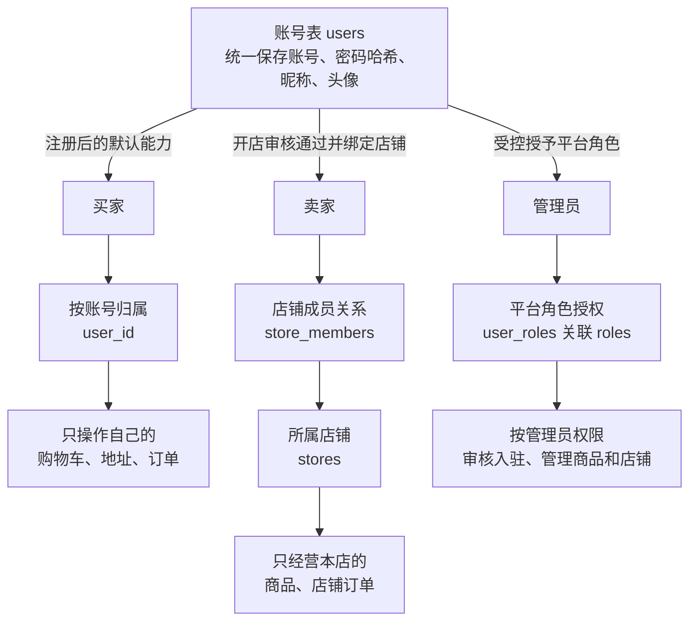
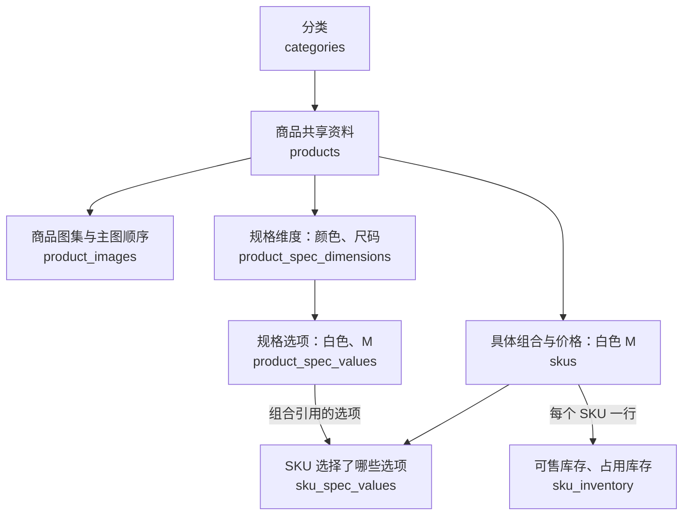
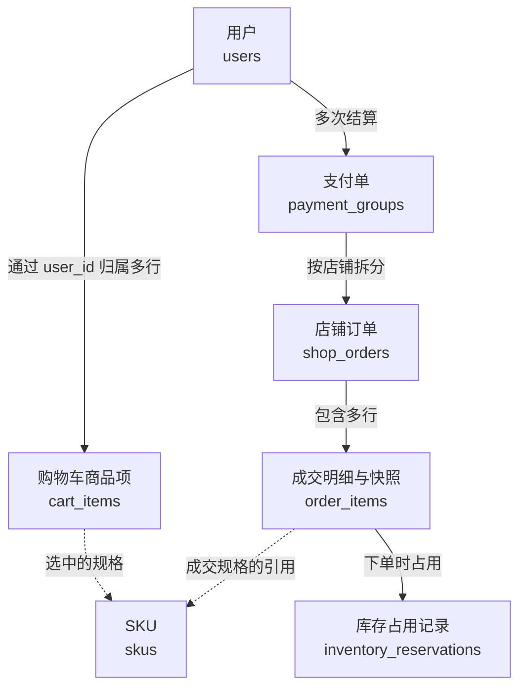

# 拾集 · 数据库结构复核 v0.2

当前环境补充（2026-10-23，D072）：复用 Mac 已安装 MySQL / Redis，不再推进 D071 第二套容器数据库；项目账号认证与独立空库仍待配置。前端暂停，当前只准备环境连接。28 表候选、字段/索引/迁移与认证方案不因环境准备一次性冻结或建表。详见 [本地开发环境](17-本地开发环境.md)。

更新日期：2026-10-20  
状态：D060 已确认可选商家展示价，D061 已确认首版仅保留购物车商品项；D062 确认同组合新 SKU 再售/启用组合唯一、数量串行、素材回收及 401 当前输入保留。P033 / P034 其余物理方案及 P035 继续待确认。业务规则沿用 D051–D062；具体字段名、类型和约束实现仍为候选，未生成 DDL、迁移或创建数据库。

最终复核入口：用户要求最后核对数据库，本轮以 [第 10 节首版定稿评审清单](#10-首版定稿评审清单p036) 汇总 5 个模块、28 张候选业务表及边界（P036）。这是可供最后确认的完整版本，未将“再确认一次”的请求推定为已接受所有候选拆表，也不生成 SQL 或自动选定数据库。

逐表字段及关联方向现展开到 [数据库字段与关联字典 P037](15-数据库字段与关联字典.md)：列出完整字段名、主键、引用目标与可空场景，并说明 `cart_items.user_id → users.id`、用户到店铺和订单的查询路径。该细化稿仍待评审，不自动冻结字段或生成物理外键。

本稿将 [数据库讨论稿](13-数据库设计.md) 中分轮讨论的方案汇总为一版可评审清单。阅读时区分：业务归属与状态规则已经确认；用几张表、字段如何命名和约束怎样落地，仍需逐项确定。本轮不新增页面、真实支付、个性化行为采集或 Agent 功能。

## 1. 已确认的设计输入

| 已确认规则 | 对数据库的要求 |
| --- | --- |
| 统一账号，可同时购物和经营；管理入口共用登录 | 账号资料与店铺、平台权限分开表达；不能用单选的买家/卖家类型覆盖全部身份 |
| 首版每账号最多拥有一家店，店铺成员结构保留扩展空间 | 用户、店铺和关联关系分开；停用店铺不释放店主归属或绕过开店上限 |
| 商品归店铺，SKU 归商品，价格和库存按 SKU 管理 | 同型号跨店各自建商品；购物车项和订单明细引用具体 SKU，无规格也有默认 SKU |
| 保存不完整商品草稿后再次打开回显 | 保留同一商品身份及已保存内容，草稿不公开；保存和正式发布使用不同完整性校验 |
| 商家选主图，可选填展示价，未填时自动采用 SKU 最低价（D060） | 图集顺序决定主图，自填展示价与实际 SKU 报价分开；自动报价沿用有货优先，筛选/排序细节见 P035 |
| 首版仅购物车商品项，直接归属用户（D061） | 不创建 `carts` 主表，注册不预建购物车记录，零项表示空购物车 |
| 规格替换保留停用旧 SKU，新组合创建新 SKU | 原组合引用不能被覆盖；旧购物车显示不能购买、灰图、点击进入原店铺 |
| 商家下架整款商品 | 保存销售状态，购物车显示商品已下架，点击进入下架状态页及推荐区 |
| 人工库存调整留痕，价格/库存修改不改变历史订单 | 调整记录包含前后数量、原因、操作者、时间；订单保留成交快照 |
| 首次发布决定上新时间，编辑和重新上架不重置 | 创建、更新、首次发布时间分别保存；未发布草稿没有发布时间 |
| 首版规则推荐与稳定轮换 | 复用分类、店铺、发布时间、SKU 价格和库存；当前不创建喜好、行为或模型运行表 |

## 2. 账号与店铺：候选表

下列字段是逻辑字段示例，不表示已经选择 SQL 类型、长度或密码/会话技术。各实体按需要保留创建/更新时间，关联表和记录表不机械套用完全相同字段。

| 候选表 | 主要字段 | 职责与关键关系 |
| --- | --- | --- |
| `users` | `id`、`login_name`、`password_hash`、`nickname`、`avatar_asset_id`、`status` | 统一账号，登录名唯一、昵称可重复，密码保存哈希 |
| `roles` | `id`、`code`、`name`、`status` | 受控的平台角色，编码唯一；首版平台管理员无需多级权限配置页面 |
| `user_roles` | `user_id`、`role_id`、`granted_at`、授予来源/操作者 | 用户与平台角色的关联，同一用户/角色组合唯一 |
| `merchant_applications` | `id`、`applicant_user_id`、拟用店名/Logo/分类/简介、`status`、`revision`、`submitted_at` | 开店申请当前资料，不在注册时预建申请或店铺 |
| `merchant_application_records` | `id`、`application_id`、提交版本、动作、操作者、原因、时间、提交资料快照 | 提交与审核历史，保留驳回后修改前的内容 |
| `stores` | `id`、`application_id`、名称、Logo、主营分类、简介、经营状态、平台限制原因 | 审批通过后创建的店铺，不把店铺名和个人昵称混用 |
| `store_members` | `id`、`store_id`、`user_id`、`role`、有效状态 | 用户在具体店铺的权限；首版使用店主关系，不实现员工管理 |

P033 推荐采用 `roles` / `user_roles`，管理员仍是 `users` 中的账号，不另建一套 `admins` 账号密码表。普通注册不授予平台管理员角色；买家能力是普通账号基础能力，经营权限来自店铺成员关系。此物理拆分仍待确认，D052 共用登录流程不等于已经确认了角色表字段。

店主归属推荐以 `store_members` 的有效 `OWNER` 关系为权威来源，不再维护可独立编辑的 `users.store_id`。需保障每店一位有效店主、每用户最多一条有效店主关系；店铺停用仍保留关系。同一申请至多创建一家店，审批通过、创建店铺和绑定店主应一致提交。

## 3. 商品与库存：候选表

P033 推荐采用此前 P028 的八张商品基础表，库存人工调整记录另列一张候选记录表。已确认的 SKU 行为不等于八张表及以下字段已经冻结。

| 候选表 | 主要字段 | 保存的内容 |
| --- | --- | --- |
| `categories` | `id`、`parent_id`、`name`、`sort_order`、`status` | 分类名称和层级，多个商品可使用同一分类 |
| `products` | `id`、`store_id`、`category_id`、`title`、`description`、事实参数、可空 `display_price_override`、`sale_status`、平台限制、`published_at` | 一款商品共享内容与可选商家展示价；实际售价/库存仍由 SKU 管理，清空展示价恢复自动计算 |
| `product_images` | `id`、`product_id`、`asset_id`、`sort_order` | 商品图集；商家将主图排在第一位 |
| `product_spec_dimensions` | `id`、`product_id`、`name`、`sort_order` | 商品的规格维度，例如颜色、尺码；首版最多两个维度 |
| `product_spec_values` | `id`、`dimension_id`、`value`、`sort_order` | 每个维度的选项，例如白色、M 码；保留被旧 SKU 引用的原含义 |
| `skus` | `id`、`product_id`、`spec_key`、`price`、可选 `product_image_id`、`status` | 可购买组合、整数分售价、启停和可选规格图 |
| `sku_spec_values` | `sku_id`、`dimension_id`、`value_id` | 某 SKU 具体选择了每个维度的哪个值，不重复保存价格或库存 |
| `sku_inventory` | `sku_id`、`available_stock`、`reserved_stock`、更新时间；并发版本字段待选 | SKU 的可售和占用数量，一 SKU 对应一行库存 |
| `inventory_adjustment_records`（本轮候选） | `id`、`sku_id`、调整前/后可售数量、`reason`、`actor_user_id`、发生时间 | 商家人工调整库存的留痕；D055 要求的记录内容已确认，独立表方案仍待确认 |

例如：一款 T 恤在 `products` 一行，“颜色”和“尺码”是两个维度，“白色”和“M”是选项，“白色 M”对应一条 SKU，再关联自己的价格和库存。各商家共用这些表结构，通过店铺/商品/SKU ID 区分记录。

组合校验与候选唯一约束：

- 同一 SKU 在同一维度只能关联一个选项；选项必须属于该维度，维度和 SKU 必须属于同一商品。
- 发布时规格组合完整，同商品启用完整组合唯一；停用历史允许多代同组合（D062）。组合键使用稳定标识，不使用展示文字作为身份。
- 规格替换停用旧 SKU 并创建新 SKU，在一次保存中保持一致；保留旧 SKU 的原组合及历史引用。
- SKU 规格图只能关联本商品图片，未绑定或失效时回退主图。
- 可售/占用数量非负，商家修改可售量不能覆盖占用量；旧表单不能无条件覆盖期间的新交易。
- 调整数量与相应人工调整记录保持一致；库存占用/付款/释放不使用人工调整记录代替交易占用模型。

草稿可空字段、图片排序唯一性、库存并发及启用组合唯一约束的 SQL 表达，继续随字段字典细化。D062 已确定相同退役组合再售创建新 SKU、原 SKU 保持停用；不通过覆盖旧组合含义、复活旧 ID 或伪造零元价绕过约束。

## 4. 购物车与地址：D061 确认归属，字段继续细化

D061 已采纳 P034 的购物车建议：仅保留 `cart_items`，直接通过 `user_id` 归属用户，不建 `carts` 主表。没有商品项就返回空购物车，注册后同样可以打开购物车，无需预建主记录。此条取代 P033 的显式主表推荐。共享表由迁移统一建立，不为每个用户创建物理表。

| 候选表 | 主要字段 | 关键关系 |
| --- | --- | --- |
| `cart_items`（归属方案 D061 已确认） | `id`、`user_id`、`sku_id`、`quantity`、创建/更新时间 | 同一用户同一 SKU 唯一，再次加入合并数量；数量为正，服务端校验可售性 |
| `user_addresses` | `id`、`user_id`、收件人、电话、省市区、详细地址、默认标记、创建/更新时间 | 用户地址簿，与订单收货快照分开 |

购物车按 SKU → 商品 → 店铺关系分组展示，不需要为店铺另建购物车。`(user_id, sku_id)` 保证同一用户同一 SKU 唯一，具体索引随数据库产品细化。若将来出现新的购物车级业务状态，再单独评估主表；它不再是当前首版待选项，不维护另一份 `cart_id` 归属。

按 D061，注册不写入购物车主记录，也不预填地址、订单、商品项、商家申请或店铺；用户此前希望的“注册后拥有空购物车”体验仍然成立。首次加购时创建商品项。价格、店铺与可售性通过实际 SKU 关联读取，金额由后端重算，不采用商家自填展示价计费；购物车完整私有接口和跨设备勾选不在本轮提前冻结。

## 5. 支付、订单与占用：候选表

一次跨两家店结算对应一个支付单、两个店铺订单，各店独立履约。下列具体表和字段仍为复核提案，交易规则沿用既有产品/技术规划。

| 候选表 | 主要字段 | 作用 |
| --- | --- | --- |
| `payment_groups` | `id`、支付单号、`buyer_user_id`、总金额分、币种、状态、截止/支付/关闭时间、关闭原因 | 一次合并结算及统一付款，不承担发货状态 |
| `shop_orders` | `id`、订单号、`payment_group_id`、`store_id`、状态、金额、店铺名与收货快照、演示物流及履约时间 | 一家店独立发货与完成，同一支付单同一店铺至多一笔 |
| `order_items` | `id`、`shop_order_id`、`product_id`、`sku_id`、商品/规格/图片快照、成交单价分、数量、行金额 | 已成交商品明细，不从商品当前内容重建历史 |
| `inventory_reservations` | `id`、`order_item_id`、`sku_id`、数量、占用/确认/释放状态及时间 | 每条订单明细至多一条占用记录，防止重复扣减或释放 |
| `payment_events` | 事件唯一键、`payment_group_id`、结果、处理时间 | 模拟付款事件去重，不接入真实支付凭证 |
| `idempotency_records` | 调用者、操作范围、幂等键、请求摘要、状态、关联结果 | 重试返回原结果，同键不同请求拒绝 |

订单快照是逻辑字段集合，拆成列还是使用受约束的结构化字段在详细设计时确定。金额均使用整数分，由服务端统一计算；同次结算的支付单、店铺订单、明细和占用一致提交，任一商品失败则整体回滚。

收货快照包含下单时的收件人、电话、省市区和详细地址，复制到各 `shop_orders`。可保留来源地址 ID 用于追溯，但不能仅靠地址簿外键恢复历史；买家之后修改或删除地址簿不改变已生成订单的收货快照。

库存初始可售 10、占用 0，下单两件后变为可售 8、占用 2；付款后可售仍为 8、占用归零，取消未付款单则恢复可售 10、占用归零。付款和关闭互斥且幂等，不能付款时再次扣一遍可售库存。

## 6. 已有功能的配套记录

| 候选表 / 机制 | 主要数据 | 边界 |
| --- | --- | --- |
| `media_assets` | 归属、存储后端、对象键、文件类型/大小、状态 | 供头像、店铺 Logo、商品图引用，不把临时签名地址当永久标识；历史素材保留策略随引用设计 |
| `user_notifications` | 收件人、事件唯一键、类型、目标、创建/已读时间 | 支撑消息与角标，目标访问仍需鉴权，不是即时聊天表 |
| `feedback` | 提交者、内容、处理状态、时间 | 帮助与问题反馈，不引入客服对话系统 |
| `platform_action_records` | 管理员、目标、动作、原因、时间 | 商品限制、店铺停用/解除的历史，与目标状态一致提交 |
| 登录会话持久化机制 | 随最终认证方案确定 | Cookie / JWT 及会话落库方式未选，不提前生成两套 Session/刷新令牌表 |

审核记录、平台操作记录、人工库存调整记录和交易占用记录各自描述不同业务事件；是否统一底层记录机制继续评审，不因本清单自动创建所有候选表。

## 7. 分模块关系图（按本轮候选绘制）

以下三张图用于解释结构；购物车商品项直接归属用户已由 D061 确认，其余物理拆表仍按 P033 / P034 待确认。箭头文字说明包含、关联或归属；第三张图的虚线表示购物车项/订单明细引用同一个 SKU。省略地址、消息、素材和操作记录等配套关系，完整候选字段见前文。

### 7.1 买家、卖家、管理员怎样共用账号表

`users` 是保存所有账号的一张共享表，买家、卖家和管理员是账号具备的能力。买家是默认基础能力，不需要单独的买家账号表；卖家权限由具体店铺成员关系确认，平台管理员权限由受控角色关联授予。一个账号可以同时具备购物和经营能力，管理员角色不会由普通注册或开店自动获得，权限均由后端检查。

例如：张三注册时是买家，开店通过后仍使用同一个账号，同时具有买家和卖家能力；管理员李四也保存在 `users`，通过 `user_roles` 关联管理员角色。管理员可以使用专用账号，该账号依然使用相同账号表和认证机制。

首版一个账号最多拥有一家店。开店申请与审核历史仍在第 2 节候选表中，本图聚焦身份取得方式、授权关联和资源范围，不表示删除申请/审核记录表或确认全部物理字段。

### 7.2 一款商品怎样形成可购买的规格

`products` 保存一款商品共用的资料；`skus` 表示实际选购的组合并保存价格；`sku_spec_values` 把这个组合与颜色、尺码选项关联。库存单独按 SKU 保存，关系表不再重复保存价格和库存。

### 7.3 购物车与成交订单怎样关联 SKU

购物车保存准备购买的 SKU 和数量，不占库存；提交订单后，支付单按店拆出订单，明细保存成交快照并关联库存占用记录。商品之后改价、换规格或下架，不改写历史成交快照。库存占用记录与人工库存调整记录的职责分开。

## 8. 这轮需要确认的选择

| 选择 | 本轮建议 | 尚待细化 |
| --- | --- | --- |
| 平台角色如何保存 | `users` + `roles` + `user_roles`，店铺权限用 `store_members` | 授予流程、角色字段、认证会话实现 |
| 商品规格怎样拆表 | 采用第 3 节八张基础表，规格维度/选项/关联分开 | 字段可空范围、类型长度、唯一约束及索引实现 |
| 购物车归属（D061 已确认） | 仅 `cart_items.user_id`，零行表示空购物车；不建主表、不在注册时初始化 | 详细字段类型、索引与私有接口仍待设计；同一用户同一 SKU 唯一 |
| 商家展示价（D060 已确认选填） | 选填值优先；未填/清空时自动取 SKU 最低价，沿用有货优先 | P035：自填价标签、校验范围及价格筛选/排序细节待确认 |
| 人工库存修改记录怎样保存 | 独立 `inventory_adjustment_records` 候选，与库存更新一致提交 | 并发冲突控制、字段及记录表物理结构 |
| 数据库产品与通用字段 | D072 本机现有 MySQL，通用字段的物理定义待定 | ID 类型、时间类型、字段长度、条件唯一约束、迁移工具 |

上述是可评审提案，不因用户要求复核而自动转为全部已确认。待逐项确认后，再形成字段字典、ER 定稿、约束/索引清单，并与页面/API 核对；之后才生成迁移和种子数据。当前不修改 Demo，不配置云服务器或 Docker，不执行建库，也不新增 Agent/行为/喜好表。

## 9. Gemini 建议评审（P034，购物车部分已由 D061 采纳）

用户提供的第三方截图是评审材料，不直接转为已确认需求。本轮仅同步文档，没有查询压测、执行计划实测、SQL/缓存实现或数据库验收。

| 建议 | 评审结论 | 当前建议 |
| --- | --- | --- |
| 商品详情避免七表大联查 | 方向合理，不能按表数一刀切禁止 JOIN | 独立的多行集合分批查询，允许合适的一对一关联；按批组装 DTO/VO，避免逐 SKU 查询 |
| `products.min_price` 加速列表 | 可作后续优化，不因存在 SKU 就必然需要 | 先保证有货优先口径和查询正确，再结合执行计划决定派生列或缓存 |
| `shop_orders` 保存收货地址快照 | 原方案已有，认可强调完整内容 | 见第 5 节，不能只保存地址簿 ID |
| 删除 `carts` 主表 | 当前首版可简化；并非所有业务中的购物车主表都无意义 | D061 已采纳仅 `cart_items(user_id, sku_id, quantity, …)`，取代 P033 的主表推荐 |
| 补开店申请表 | 原方案已有同类结构，图示省略不代表缺表 | 继续使用候选 `merchant_applications` 与 `merchant_application_records`，不重复增加 `store_applications` |

### 9.1 查询按关系组织，避免行数膨胀和 N+1

例如一款商品有 3 张图、8 个 SKU，把这两组独立子集合直接平铺联查，可能得到 24 行重复组合，再关联其他集合会继续膨胀。可以分别批量读取商品、图片、规格维度/选项、SKU/库存及规格关联，在服务层组装；SKU 与一条库存记录等一对一关联仍可合查。不要在每个 SKU 的循环内单独查库存或规格。

不强制使用 Java Stream、并发查询或 Redis。分批读取须按业务需要考虑一致性，提交订单仍重新校验权限、价格、规格状态和库存。列表的价格过滤、排序和分页须按同一展示价口径在最终分页前完成，不能先随意取一页商品再只对页内价格排序。

[Hibernate 官方查询指南](https://docs.hibernate.org/orm/7.0/querylanguage/html_single/) 说明，多组并行的集合关联可能产生笛卡尔积，而多个一对一/多对一关联有不同特征；该资料用于解释关系展开问题，不代表本项目已选择 Hibernate。

### 9.2 起价是系统派生数据，库存变化也会影响它

下述自动报价逻辑适用于 D060 未填写商家展示价的分支。不能把 D054 简化成所有 SKU 的最低价：先在有效启用且有可售库存的 SKU 中计算起价；全部售罄时采用有效启用 SKU 的参考报价，并明确售罄。无有效启用 SKU 不进入正常货架。已填写时，最终展示价优先采用商家填写值，真实库存状态仍单独判断。

例：未填写展示价，129 元 SKU 剩 1 件，159 元 SKU 剩 8 件。129 元规格最后一件被订单占用后，自动起价应变为 159 元；取消订单释放库存后可能恢复为 129 元。因此，若将 `min_price` / `max_price` 或库存状态物化为摘要或缓存，除改价、启停、商品状态变化外，还要覆盖占用、释放、补货等改变可售资格的事件，并定义一致性和重建策略。SKU 最低价摘要由系统维护，与 D060 的商家选填展示价分开；展示缓存也须覆盖填写值修改/清空，下单仍按实际 SKU 核验。

“取最低价必然遍历所有 SKU 并成为慢查询”过于绝对。先以正确的关联、聚合和候选索引实现，再用代表性数据及执行计划判断是否需要优化；查询成本受条件、索引与优化器影响。参见 [MySQL 官方执行计划说明](https://dev.mysql.com/doc/refman/8.4/en/execution-plan-information.html)，当时仅用于解释执行计划；当前 D072 本机现有 MySQL，但仍未据此创建索引。

### 9.3 入驻材料不随截图自动扩充

当前申请候选字段为店铺名、Logo、分类、简介等，提交与审核记录另存；审核通过时创建店铺及店主成员关系须一致提交。截图提及的身份证、营业执照收集属于额外需求，尚未确认，不自动加入表字段或界面。

## 10. 首版定稿评审清单（P036）

本节将当前候选结构收敛为一套最终评审版本，不再并列维护第二套角色/规格/购物车结构。D051–D061 已确认的业务规则直接约束这套方案；尚未采纳的表拆分和 P035 仍清楚标注，不能据本清单宣称建库完成。

### 10.1 建议纳入的表清单：5 个模块，28 张业务表

下列表名为定稿建议；详细逻辑字段见第 2–6 节。它们按同一商城业务数据库规划，不代表拆成 28 个服务，当前按 D072 本机现有 MySQL 环境准备，部署与物理结构尚待实现。

| 模块 | 数量 | 表清单 | 保存什么 |
| --- | --- | --- | --- |
| 账号、入驻与店铺 | 7 | `users`、`roles`、`user_roles`、`merchant_applications`、`merchant_application_records`、`stores`、`store_members` | 账号资料、管理员授权、申请资料/审核历史、店铺及店主归属 |
| 商品、规格与库存 | 9 | `categories`、`products`、`product_images`、`product_spec_dimensions`、`product_spec_values`、`skus`、`sku_spec_values`、`sku_inventory`、`inventory_adjustment_records` | 分类、商品共享资料/可选展示价、图集、规格定义与组合、实际售价、库存及人工调整记录 |
| 购物车与地址 | 2 | `cart_items`、`user_addresses` | 用户准备购买的具体 SKU/数量及当前地址簿 |
| 交易、库存占用与防重 | 6 | `payment_groups`、`shop_orders`、`order_items`、`inventory_reservations`、`payment_events`、`idempotency_records` | 合并付款、按店履约、成交快照、占用结果、付款事件去重与写请求重试防重 |
| 素材、消息与平台记录 | 4 | `media_assets`、`user_notifications`、`feedback`、`platform_action_records` | 图片元数据、个人消息/已读状态、问题反馈和平台管理历史 |
| 合计 | 28 | 不包含尚未选型的认证会话持久化对象、迁移工具元数据或未来扩展表 | 表数量是本轮评审版本的统计，不是已执行建表数量 |

建议将角色关联、独立规格维度/选项/关联、SKU 库存及人工调整记录作为首版统一结构，不再同时设计互相覆盖的 JSON 规格定义或另一套管理员账号。上述物理拆分属于 P036 待确认部分；普通买家能力仍来自账号，经营权限来自成员关系，平台管理权限来自受控角色。

### 10.2 已确认规则的最后核对

| 核对项 | 当前规则 |
| --- | --- |
| 身份与权限 | 一张 `users` 保存买家、卖家和管理员账号；同账号可购物经营，普通注册不授予管理员。管理员共用登录，后端检查角色；首版每账号最多拥有一家店，停用不解除归属 |
| 入驻与经营 | 申请、审核记录和正式店铺职责分开；审核通过、创建店铺和绑定店主一致提交。注册不预建店铺或申请，不默认收集身份证/执照 |
| 商品与规格 | 商品归店铺，SKU 归商品；无规格也有默认 SKU。维度/选项定义与实际组合分开；所选选项、SKU、图片须属于同一商品 |
| 主图与展示价 | 主图为商家排序首图；可选填展示价，填了优先展示，未填/清空自动取有货优先的 SKU 最低价。实际售价仍在 SKU，填写值不改变库存资格，不用于购物车/结算计费 |
| 编辑与失效 | 草稿允许不完整，保存后按原商品回显续填。替换组合时保留停用旧 SKU 并创建新 SKU，原购物车不能购买、灰图、点进原店；实际零库存才显示售罄。商家整款下架则进入下架状态页及推荐区 |
| 购物车与注册 | 只建 `cart_items`，按 `user_id` 归属，零项即空购物车；首次加购新增，同用户同 SKU 合并数量。不建 `carts`，不为每个用户建物理表，不在注册时预填地址/订单等记录 |
| 交易与快照 | 一次跨店结算对应一个支付单、多个店铺订单，各店独立发货/收货。订单保存商品标题/图片/规格/成交价、店铺名和完整收货快照，商品或地址簿后续修改不重写历史 |
| 库存 | 提交时从可售转占用；付款确认占用，不能再次扣可售；未付款取消/超时只释放一次。人工修改只调整可售部分并留痕，不能用旧表单覆盖交易变化 |
| 范围 | 首版不建立 Agent、行为喜好、优惠券、评价、收藏、退款、商家资金结算或即时聊天表；认证会话机制选定后再确定其持久化对象 |

### 10.3 唯一性、归属与一致性核对

以下列出逻辑保障目标，SQL 约束形式和必要索引随数据库选型确定，不把每项都误写成单列唯一索引：

- 账号登录名、角色编码、用户与角色组合不可重复；管理员授权不能由普通注册或个人资料接口写入。
- 同一店铺成员组合不可重复；每店一名有效店主、每用户最多一条有效店主归属。店铺停用仍保留归属；同一申请不得重复创建店铺。
- 商品内启用 SKU 的完整组合不得重复，停用历史可多代同组合（D062）；同一 SKU 同一维度只能选一个选项，须交叉校验归属。新 ID 再售不恢复旧购物车；历史含义不能覆盖，不能使用全历史组合唯一键阻止再售。
- 库存按 SKU 唯一，可售/占用数量非负；更新与对应调整/占用记录保持一致，事务并发控制不能只依赖先读后写。
- 购物车 `(user_id, sku_id)` 唯一，数量为正；地址只由本人操作，同一用户至多一个默认地址。D064：名下无地址时新建首条自动默认，后续新增仅显式 true 才切换原默认。
- 支付单号、订单号唯一；同一支付单同一店铺至多一笔订单，同一订单明细至多一条占用记录，引用 SKU 必须归属订单店铺。
- 付款事件按可信事件唯一键去重；写请求幂等按调用者、操作范围与幂等键识别，同键同请求返回原结果，同键不同请求拒绝。消息事件去重须包含收件人范围，不能让多收件人的同一事件互相覆盖。
- 成交金额由服务端按实际 SKU 计算并保存快照，行金额/订单/支付合计保持一致，金额使用整数分。跨行汇总、权限和状态转换由事务内校验保障，不能只靠前端或单列 CHECK。
- 业务下架/停用采用状态管理，保留历史引用；不级联删除历史商品/SKU/订单，不因地址簿删除而破坏收货快照。历史图像不能仅依赖会过期的签名 URL。

### 10.4 定表与细化接口的边界

| 后续项 | 当前状态 | 对本轮表关系的影响 |
| --- | --- | --- |
| P036 的 28 表清单 | 本轮收敛的最终评审建议，待确认 | 确认后用于字段字典和完整 ER 定稿，不再把旧候选结构并列实施 |
| 数据库与工程选型 | D072 复用本机 MySQL，项目认证待验证；ID/时间类型、持久化及迁移工具待确定 | 不自动套用某产品 DDL；选定后给出类型、索引和约束实现 |
| P035 自填展示价 | 选填优先已由 D060 确认；标签、对应 SKU/价差校验、价格过滤/排序及推荐近价口径仍待确认 | 保留原始填写值、最终展示值/来源与实际 SKU 价区间即可支撑，不需为不同价格来源建多套商品表 |
| D062 四项完善 | 同组合新 ID 再售/启用组合唯一、数量单项串行、素材核查回收、401 当前内存输入保留已确认 | 复用现有业务实体，唯一约束 SQL、素材回收期限/状态和认证技术仍待工程确定，不新增业务表或直接执行任务 |
| 细节与参数 | 草稿可空字段、启用组合唯一约束表达、库存编辑冲突方案、详情默认 SKU、关单时长及推荐参数待细化 | 明确到字段字典、状态转换与接口契约；不将参数未定写为业务未设计，也不擅自引入新功能 |
| 正式工程接入 | 尚未接入，无数据库或正式 API | 确认清单后联合核对页面/API/字段，再写迁移和种子数据；Java 阶段统一维护商城 schema，后续 Python 复用规则 |

本轮只执行文档一致性检查，没有运行数据库、SQL、EXPLAIN、容器、接口测试或功能验收，也没有修改 Demo。

相关文档：[产品规划](01-产品规划.md)、[技术方案](02-技术与Agent方案.md)、[数据库讨论](13-数据库设计.md)、[决策记录](04-决策记录.md)、[原型与实施进度](09-原型进度与文档维护.md)。
