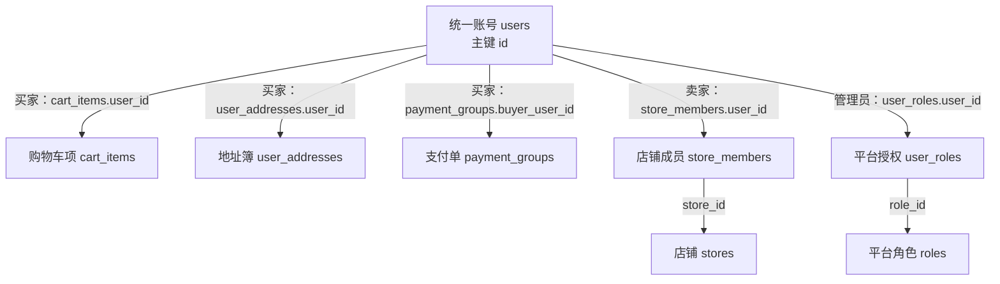
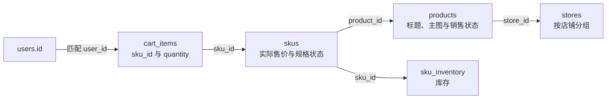
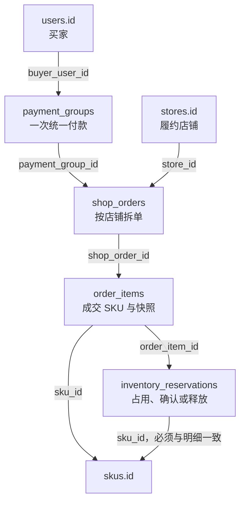

# 拾集 · 数据库字段与关联字典 v0.1

当前环境补充（2026-10-23，D072）：复用 Mac 已安装 MySQL / Redis，不再推进 D071 第二套容器数据库；项目账号认证与独立空库仍待配置。前端暂停，当前只准备环境连接。28 表候选、字段/索引/迁移与认证方案不因环境准备一次性冻结或建表。详见 [本地开发环境](17-本地开发环境.md)。

更新日期：2026-10-20  
状态：P037 字段与关联评审稿，展开 P036 的 28 张候选业务表；已确认行为沿用 D051–D062，不代表所有字段及物理约束已被用户采纳。D062 更新启用组合唯一及素材回收等行为，字段/SQL 形式继续细化。D072 复用本机 MySQL；未生成 DDL、迁移或创建项目数据库。

本稿优先回答“关联字段放在哪里、能沿哪条路径查到数据”。字段名为统一建议，金额均为整数分；具体 ID/时间/文本类型、长度、索引、枚举编码及 SQL 外键实现另行确定。`FK` 表示建议建立引用约束的关系，不表示已经执行建库；仅靠普通外键不能代替跨表归属、权限和事务校验。

## 1. 先看 users 与其他表怎样关联

### 1.1 购物车项保存 user_id，不在 users 保存 cart_id

`cart_items.user_id → users.id` 表示每个购物车项属于一个用户；同一个用户可以有零到多个购物车项。`users` 不需要 `cart_id`、`cart_item_ids`、`order_ids` 或 `store_ids` 等数组字段。查询用户的购物车，就是按该用户 ID 查 `cart_items.user_id`。

虚构数据示例：

| users.id | login_name |
| --- | --- |
| 1001 | demo_buyer |

| cart_items.id | user_id | sku_id | quantity |
| --- | --- | --- | --- |
| 501 | 1001 | 2001 | 2 |
| 502 | 1001 | 2008 | 1 |

用户 1001 的购物车包含两种 SKU、共三件商品，全部由两行商品项表达；用户 1002 没有商品项也能返回空购物车。服务端通过当前认证身份确定用户范围，不能信任客户端任意传入其他人的 `user_id`。

Java 对象以后可以映射一个用户的购物车项集合，但这是对象关联，不是在 `users` 内新增一列来存整个购物车。关联方向不妨碍双向查询：从用户查商品项，或从商品项查所属用户，都使用同一组键。

### 1.2 买家、卖家、管理员的主要关联路径

图中箭头从账号向外说明查找路径；真正保存外键的是箭头标签指定的表。买家不是另一张账号表，商家不是另一份密码，管理员也不另建登录账号表。

### 1.3 所有直接引用 users 的字段

| 引用字段 | users 在这条关系中的身份 | 从一个用户可以关联多少行 |
| --- | --- | --- |
| `cart_items.user_id` | 购物车项的所有者 | 0–N |
| `user_addresses.user_id` | 地址所有者 | 0–N |
| `payment_groups.buyer_user_id` | 买家 | 0–N |
| `store_members.user_id` | 店铺成员，首版是店主 | 首版 0–1 条有效店主归属，结构保留扩展 |
| `user_roles.user_id` | 被授予平台角色的账号 | 0–N |
| `user_roles.granted_by_user_id` | 授权操作者 | 0–N；受控初始化授权时可空 |
| `merchant_applications.applicant_user_id` | 开店申请人 | 0–N 历史申请；并发有效申请策略待细化，不等于允许多店 |
| `merchant_application_records.actor_user_id` | 提交申请或执行审核的人 | 0–N |
| `inventory_adjustment_records.actor_user_id` | 人工库存调整者 | 0–N |
| `idempotency_records.actor_user_id` | 写请求的已认证调用者 | 0–N |
| `media_assets.owner_user_id` | 上传素材的归属账号 | 0–N |
| `user_notifications.user_id` | 消息收件人 | 0–N |
| `feedback.user_id` | 问题反馈提交者 | 0–N |
| `feedback.handler_user_id` | 反馈处理者（建议字段） | 0–N；未处理时可空 |
| `platform_action_records.actor_user_id` | 平台管理动作执行者 | 0–N |

`users.avatar_asset_id` 则方向相反：账号可引用一张素材。初始头像可以使用内置默认资源，此字段为空；注册不必先上传素材。素材归属账号与素材被哪张业务表引用是两种关系，不能混同。

## 2. 账号、入驻和店铺：7 张表

### 2.1 users：账号

| 字段 | 含义 | 键与关联 |
| --- | --- | --- |
| `id` | 账号 ID | PK |
| `login_name` | 登录名 | 唯一 |
| `password_hash` | 密码哈希 | 不保存明文密码 |
| `nickname` | 展示昵称 | 可重复 |
| `avatar_asset_id` | 用户头像素材 | 可空 FK → `media_assets.id` |
| `status` | 账号可用状态 | 禁用状态由后端校验 |
| `created_at` | 注册时间 | 服务端生成 |
| `updated_at` | 最后更新时间 | 服务端生成 |

不保存商家身份单选值，也不加可独立编辑的 `store_id`；经营归属从 `store_members` 取得。

### 2.2 roles：平台角色

| 字段 | 含义 | 键与关联 |
| --- | --- | --- |
| `id` | 角色 ID | PK |
| `code` | 角色编码，例如 PLATFORM_ADMIN | 唯一 |
| `name` | 角色名称 | 展示名称 |
| `status` | 是否有效 | 与授权关系一起校验 |
| `created_at` | 创建时间 | 服务端生成 |
| `updated_at` | 更新时间 | 服务端生成 |

### 2.3 user_roles：账号与平台角色

| 字段 | 含义 | 键与关联 |
| --- | --- | --- |
| `user_id` | 被授权账号 | 组合 PK；FK → `users.id` |
| `role_id` | 获得的角色 | 组合 PK；FK → `roles.id` |
| `granted_by_user_id` | 授权操作者 | 可空 FK → `users.id`；受控初始化时可空 |
| `grant_source` | 受控初始化或管理授权等来源 | 不接收普通注册自报来源 |
| `granted_at` | 授权时间 | 服务端生成 |

组合主键为 `(user_id, role_id)`。查询一个账号的管理员权限：`users → user_roles → roles`，普通买家能力不要求先插入 BUYER 角色。

### 2.4 merchant_applications：开店申请当前版本

| 字段 | 含义 | 键与关联 |
| --- | --- | --- |
| `id` | 申请 ID | PK |
| `applicant_user_id` | 申请人 | FK → `users.id` |
| `store_name` | 拟用店名 | 草稿可未填 |
| `logo_asset_id` | 拟用店铺 Logo | 可空 FK → `media_assets.id` |
| `main_category_id` | 拟用主营分类 | 可空 FK → `categories.id` |
| `description` | 店铺介绍 | 草稿可未填 |
| `status` | 草稿、待审核、通过、驳回 | 状态转换受控 |
| `revision` | 提交版本号 | 区分驳回修改前后 |
| `submitted_at` | 最近一次提交时间 | 草稿时可空 |
| `created_at` | 创建时间 | 服务端生成 |
| `updated_at` | 更新时间 | 服务端生成 |

### 2.5 merchant_application_records：提交与审核记录

| 字段 | 含义 | 键与关联 |
| --- | --- | --- |
| `id` | 记录 ID | PK |
| `application_id` | 对应申请 | FK → `merchant_applications.id` |
| `revision` | 针对哪个提交版本 | 与申请版本核对 |
| `action` | 提交、通过或驳回 | 不接受任意修改结果 |
| `actor_user_id` | 申请人或审核人 | FK → `users.id` |
| `reason` | 审核原因等说明 | 驳回时必填 |
| `submitted_snapshot` | 该版本提交资料的不可变快照 | 提交记录保存；审核记录可通过申请/版本定位 |
| `occurred_at` | 发生时间 | 服务端生成 |

一份申请可以有多条记录，不把审核人和提交人混成同一个“用户归属”。记录为历史数据，不随当前申请内容一起覆盖。

### 2.6 stores：正式店铺

| 字段 | 含义 | 键与关联 |
| --- | --- | --- |
| `id` | 店铺 ID | PK |
| `application_id` | 创建该店的已通过申请 | 唯一 FK → `merchant_applications.id` |
| `name` | 正式店名 | 与个人昵称分开 |
| `logo_asset_id` | 店铺 Logo | 可空 FK → `media_assets.id`，允许内置默认资源 |
| `main_category_id` | 主营分类 | FK → `categories.id`；具体发布必填规则待细化 |
| `description` | 店铺介绍 | 商家可维护 |
| `status` | 正常、停用 | 停用不释放店主归属 |
| `restriction_reason` | 当前停用原因 | 正常时可空，历史另有记录 |
| `created_at` | 开店成功时间 | 服务端生成 |
| `updated_at` | 更新时间 | 服务端生成 |

店主不是再填一个可独立修改的字段：用成员表确定。一份申请至多创建一家店；审核通过、创建店铺与绑定店主同一事务提交。

### 2.7 store_members：店铺成员与经营权限

| 字段 | 含义 | 键与关联 |
| --- | --- | --- |
| `id` | 成员关系 ID | PK |
| `store_id` | 所属店铺 | FK → `stores.id` |
| `user_id` | 成员账号 | FK → `users.id` |
| `role` | 店内角色，首版 OWNER | 与平台 roles 分开 |
| `status` | 关系是否有效 | 店铺停用时不自动解除归属 |
| `created_at` | 绑定时间 | 服务端生成 |
| `updated_at` | 更新时间 | 服务端生成 |

`(store_id, user_id)` 唯一；首版每店一名有效店主、每账号最多一条有效店主归属。管理员不会因为有平台角色就自动成为某家店的店主。

## 3. 商品、规格和库存：9 张表

### 3.1 categories：分类

| 字段 | 含义 | 键与关联 |
| --- | --- | --- |
| `id` | 分类 ID | PK |
| `parent_id` | 上级分类 | 可空自引用 FK → `categories.id` |
| `name` | 分类名称 | 兄弟分类重名策略待细化 |
| `sort_order` | 展示顺序 | 排序用途 |
| `status` | 启用状态 | 不直接删除被商品引用的分类 |
| `created_at` | 创建时间 | 服务端生成 |
| `updated_at` | 更新时间 | 服务端生成 |

### 3.2 products：商品共享资料

| 字段 | 含义 | 键与关联 |
| --- | --- | --- |
| `id` | 商品 ID | PK |
| `store_id` | 归属店铺 | FK → `stores.id` |
| `category_id` | 商品分类 | 草稿可空 FK → `categories.id`；发布需有效分类 |
| `title` | 商品标题 | 草稿可未填，发布需完整 |
| `description` | 商品详情介绍 | 与规格选项分开 |
| `attributes` | 型号、材质等事实参数 | 结构化内容候选；不是第二套 SKU 定义 |
| `display_price_override` | 商家选填展示价 | 可空、整数分；空值恢复自动计算 |
| `sale_status` | 草稿、在售、下架 | 商家销售状态 |
| `platform_status` | 正常或平台限制 | 与商家上下架分开 |
| `platform_restriction_reason` | 当前平台限制原因 | 可空，历史另存 |
| `published_at` | 首次成功发布时间 | 未发布时可空，编辑/重上架不重置 |
| `created_at` | 创建时间 | 服务端生成 |
| `updated_at` | 更新时间 | 服务端生成 |

商品不直接归某个 `user_id`：经营者通过 `store_members` 获得本店权限。`display_price`、`display_price_source`、`min_price`、`max_price` 是查询层组装结果，首版不因有这些响应字段就全部新增为可编辑商品列；商家原值只有 `display_price_override`。

### 3.3 product_images：图集与主图顺序

| 字段 | 含义 | 键与关联 |
| --- | --- | --- |
| `id` | 商品图关联 ID | PK |
| `product_id` | 属于哪款商品 | FK → `products.id` |
| `asset_id` | 使用哪张素材 | FK → `media_assets.id` |
| `sort_order` | 图集顺序，首图为主图 | 同商品排序约束待物理细化 |
| `created_at` | 关联时间 | 服务端生成 |
| `updated_at` | 更新时间 | 服务端生成 |

### 3.4 product_spec_dimensions：规格维度

| 字段 | 含义 | 键与关联 |
| --- | --- | --- |
| `id` | 规格维度 ID | PK |
| `product_id` | 所属商品 | FK → `products.id` |
| `name` | 颜色、尺码等维度名称 | 不是某个具体选项 |
| `sort_order` | 维度展示顺序 | 首版最多两个维度 |
| `created_at` | 创建时间 | 服务端生成 |
| `updated_at` | 更新时间 | 服务端生成 |

### 3.5 product_spec_values：规格选项

P040 疏漏复核指出：保留旧规格引用后，还须区分当前编辑定义与仅供历史追溯的定义，否则替换维度后可能把多于两个历史维度都当成当前规格。接口草案已分 `dimensions` 与 `historical_dimensions`；具体用状态/版本字段或等效关联表达仍待确认，以下字段清单暂未补入未选定的物理列，不能据此直接生成完整迁移。

| 字段 | 含义 | 键与关联 |
| --- | --- | --- |
| `id` | 选项 ID | PK |
| `dimension_id` | 属于哪个维度 | FK → `product_spec_dimensions.id` |
| `value` | 白色、M 码等具体选项 | 保留旧 SKU 引用含义 |
| `sort_order` | 选项顺序 | 排序用途 |
| `created_at` | 创建时间 | 服务端生成 |
| `updated_at` | 更新时间 | 服务端生成 |

无需再加可独立编辑的 `product_id`：通过维度确定商品。被历史 SKU 引用的值不能删除或改写成另一个规格含义。

### 3.6 skus：实际购买组合及售价

| 字段 | 含义 | 键与关联 |
| --- | --- | --- |
| `id` | SKU ID | PK |
| `product_id` | 所属商品 | FK → `products.id` |
| `spec_key` | 按稳定规格 ID 生成的规范组合键 | D062：同商品启用完整组合唯一，停用历史可多代同 key；草稿不完整键及条件约束 SQL 待选 |
| `price` | 实际售价 | 整数分；草稿可待补充，发布须有效正价 |
| `product_image_id` | 可选规格图 | 可空 FK → `product_images.id`，且须属于本商品 |
| `status` | 启用或停用 | 替换后保留停用的旧 SKU |
| `created_at` | 创建时间 | 服务端生成 |
| `updated_at` | 更新时间 | 服务端生成 |

不重复保存 `store_id`、`seller_user_id`；店铺通过商品取得。组合选项在下一张表关联，售价与库存也不复制进规格选项表。

同组合再售已由 D062 采纳，见 [接口文档 18.3](16-接口文档.md#183-同组合再售的建议表达)：旧 SKU 保持停用，新 ID 可再次使用相同完整组合，唯一性只约束同时启用组合。已替换 G04 的历史重复即冲突占位；旧购物车继续引用旧 SKU。不能建立无条件 (product_id,spec_key) 或 (product_id,spec_key,status) 唯一约束来限制相同停用历史只能一条，具体条件约束由数据库选型确定；本轮不生成 SQL。

### 3.7 sku_spec_values：SKU 选中了哪些选项

| 字段 | 含义 | 键与关联 |
| --- | --- | --- |
| `sku_id` | 哪个 SKU | 组合 PK；FK → `skus.id` |
| `dimension_id` | 哪个维度 | 组合 PK；FK → `product_spec_dimensions.id` |
| `value_id` | 该维度选中的值 | FK → `product_spec_values.id` |

组合主键 `(sku_id, dimension_id)` 保证一个 SKU 在一个维度最多选一个值。还须校验 `value_id` 属于该维度，维度和 SKU 属于同一商品；三条普通外键本身不能保证这些交叉关系。发布时要求组合完整；无规格默认 SKU 可以没有选项关联。

### 3.8 sku_inventory：SKU 库存

| 字段 | 含义 | 键与关联 |
| --- | --- | --- |
| `sku_id` | 库存对应 SKU | PK 且 FK → `skus.id` |
| `available_stock` | 可供新订单购买的数量 | 非负 |
| `reserved_stock` | 已提交未付款订单的占用数量 | 非负 |
| `version` | 编辑冲突检测版本（候选） | 是否采用版本条件随并发方案确定 |
| `updated_at` | 最近库存变更时间 | 服务端生成 |

有效可售 SKU 对应一条库存；允许未完成草稿尚未生成 SKU/库存。`sku_id` 同时作主键和外键，保证一个 SKU 最多一行库存，不需要另一份可独立编辑的商品总库存。

P040 接口复核建议一旦实际创建 SKU，就同步建立库存行，初始可售未填取 0；空草稿尚无 SKU 时仍不需要库存。这一候选补全已有草稿 SKU 后续可取得库存编辑令牌并继续调整的路径，尚未作为数据库默认值或初始化实现执行。

### 3.9 inventory_adjustment_records：人工调整记录

| 字段 | 含义 | 键与关联 |
| --- | --- | --- |
| `id` | 调整记录 ID | PK |
| `sku_id` | 调整哪个 SKU | FK → `skus.id` |
| `before_available_stock` | 调整前可售数量 | 由事务内真实值取得 |
| `after_available_stock` | 调整后可售数量 | 与实际更新一致 |
| `reason` | 调整原因 | 保留说明 |
| `actor_user_id` | 操作者 | FK → `users.id` |
| `occurred_at` | 操作时间 | 服务端生成 |

这张表说明“谁手动改了库存”，不代替订单占用记录。实际是否可操作仍按所属店铺关系鉴权。

## 4. 购物车与地址：2 张表

### 4.1 cart_items：用户的购物车商品项

| 字段 | 含义 | 键与关联 |
| --- | --- | --- |
| `id` | 商品项 ID | PK |
| `user_id` | 谁的购物车项 | FK → `users.id` |
| `sku_id` | 准备购买的实际规格 | FK → `skus.id` |
| `quantity` | 数量 | 正整数 |
| `created_at` | 首次加入时间 | 服务端生成 |
| `updated_at` | 最近修改时间 | 服务端生成 |

`(user_id, sku_id)` 唯一。购物车项不存 `cart_id`，也不另存可编辑的店铺、商品归属、标题、成交价或库存。沿 SKU 查询当前价格与状态；停用旧 SKU 仍保留原组合，因此能表达“所选商品不能购买”。

### 4.2 user_addresses：用户地址簿

| 字段 | 含义 | 键与关联 |
| --- | --- | --- |
| `id` | 地址 ID | PK |
| `user_id` | 地址所有者 | FK → `users.id` |
| `recipient_name` | 收件人 | 地址内容 |
| `recipient_phone` | 联系电话 | 仅授权范围可见 |
| `province` | 省级地区 | 区域代码体系待细化 |
| `city` | 城市 | 区域内容 |
| `district` | 区县 | 区域内容 |
| `detail_address` | 详细地址 | 不从昵称推断 |
| `is_default` | 是否默认地址 | 同用户至多一个默认值；D064：没有任何地址时新建首条自动为 true，后续新增仅显式 true 才切换默认 |
| `created_at` | 创建时间 | 服务端生成 |
| `updated_at` | 更新时间 | 服务端生成 |

## 5. 交易、占用与防重：6 张表

### 5.1 payment_groups：统一支付单

| 字段 | 含义 | 键与关联 |
| --- | --- | --- |
| `id` | 支付单 ID | PK |
| `payment_no` | 业务支付单号 | 唯一 |
| `buyer_user_id` | 买家 | FK → `users.id` |
| `total_amount` | 本次统一付款金额 | 整数分，服务端汇总 |
| `currency` | 币种 | 首版 CNY |
| `status` | 待付款、已付款、已关闭 | 不能承担统一发货状态 |
| `expires_at` | 待付款截止时间 | 时长参数另定 |
| `paid_at` | 付款时间 | 未付款时可空 |
| `closed_at` | 关闭时间 | 未关闭时可空 |
| `close_reason` | 取消、超时等关闭原因 | 可空 |
| `created_at` | 提交结算时间 | 服务端生成 |
| `updated_at` | 更新时间 | 服务端生成 |

### 5.2 shop_orders：店铺订单

| 字段 | 含义 | 键与关联 |
| --- | --- | --- |
| `id` | 店铺订单 ID | PK |
| `order_no` | 业务订单号 | 唯一 |
| `payment_group_id` | 属于哪次统一付款 | FK → `payment_groups.id` |
| `store_id` | 哪家店履约 | FK → `stores.id` |
| `status` | 待付款、待发货、待收货、完成、关闭 | 按店铺推进 |
| `goods_amount` | 商品金额合计 | 整数分 |
| `shipping_amount` | 运费 | 整数分，首版按演示包邮规则取 0 |
| `total_amount` | 本店应付金额 | 整数分，不使用展示价计费 |
| `store_name_snapshot` | 下单时店名 | 文本快照，不随改名变化 |
| `recipient_name_snapshot` | 收件人快照 | 独立于地址簿 |
| `recipient_phone_snapshot` | 电话快照 | 独立于地址簿 |
| `province_snapshot` | 省级地区快照 | 独立于地址簿 |
| `city_snapshot` | 城市快照 | 独立于地址簿 |
| `district_snapshot` | 区县快照 | 独立于地址簿 |
| `detail_address_snapshot` | 详细地址快照 | 独立于地址簿 |
| `shipping_carrier` | 演示物流承运信息 | 未发货可空 |
| `tracking_no` | 演示物流单号 | 未发货可空 |
| `shipped_at` | 发货时间 | 未发货可空 |
| `received_at` | 买家确认收货时间 | 未收货可空 |
| `closed_at` | 待付款关闭时间 | 未关闭可空 |
| `close_reason` | 关闭原因 | 可空 |
| `created_at` | 下单时间 | 服务端生成 |
| `updated_at` | 更新时间 | 服务端生成 |

`(payment_group_id, store_id)` 唯一。买家通过 `payment_group_id → payment_groups.buyer_user_id` 取得，不再另设一份可独立编辑的买家归属；买家查订单和接口鉴权都须沿此关系核对。收货信息直接保存完整快照，首版不要求引用可被删除的地址簿行，避免历史订单依赖当前地址。

### 5.3 order_items：成交明细

| 字段 | 含义 | 键与关联 |
| --- | --- | --- |
| `id` | 明细 ID | PK |
| `shop_order_id` | 属于哪笔店铺订单 | FK → `shop_orders.id` |
| `product_id` | 当时的商品引用 | FK → `products.id`，须与 SKU 所属商品一致 |
| `sku_id` | 当时的实际规格引用 | FK → `skus.id` |
| `product_title_snapshot` | 商品标题快照 | 不从当前标题重建 |
| `sku_spec_snapshot` | 颜色/尺码等组合快照 | 保存当时的可读含义 |
| `image_asset_id_snapshot` | 当时图片素材引用 | 可空 FK → `media_assets.id`；素材对象须保持稳定且不随商品编辑删除 |
| `unit_price` | 成交单价 | 整数分，按实际 SKU 报价核验 |
| `quantity` | 成交数量 | 正整数 |
| `line_amount` | 该明细金额 | 整数分，单价乘数量 |
| `created_at` | 成交明细创建时间 | 服务端生成 |

图片快照引用稳定素材，不保存会过期的签名 URL 作为唯一来源。商品/SKU 引用用于追溯，历史页面的标题、规格与成交价由快照渲染，不从已编辑的商品重建。

### 5.4 inventory_reservations：订单库存占用

| 字段 | 含义 | 键与关联 |
| --- | --- | --- |
| `id` | 占用记录 ID | PK |
| `order_item_id` | 对应哪条订单明细 | 唯一 FK → `order_items.id` |
| `sku_id` | 占用哪个 SKU | FK → `skus.id`，必须与明细一致 |
| `quantity` | 占用数量 | 必须与明细一致 |
| `status` | 占用、已确认或已释放 | 后两种是互斥后续结果 |
| `reserved_at` | 占用时间 | 下单时生成 |
| `confirmed_at` | 付款确认时间 | 未确认可空 |
| `released_at` | 未付款关闭释放时间 | 未释放可空 |

SKU 和数量在此保留为库存操作的明确目标，须与明细交叉校验，不能成为另一套可独立修改的成交内容。一条成功提交的订单明细对应一条占用结果记录。

### 5.5 payment_events：模拟付款事件

| 字段 | 含义 | 键与关联 |
| --- | --- | --- |
| `event_key` | 可信付款事件唯一标识 | PK，去重键 |
| `payment_group_id` | 对应支付单 | FK → `payment_groups.id` |
| `event_type` | 模拟付款事件类型 | 不接入真实网关 |
| `result_status` | 事件处理结果 | 不能任意覆盖支付单状态 |
| `received_at` | 收到事件时间 | 服务端生成 |
| `processed_at` | 完成处理时间 | 未处理可空 |

### 5.6 idempotency_records：写请求防重

| 字段 | 含义 | 键与关联 |
| --- | --- | --- |
| `id` | 防重记录 ID | PK |
| `actor_user_id` | 发起写操作的已认证账号 | FK → `users.id` |
| `operation_scope` | 结算提交等操作范围 | 防止不同命令互相复用同一个键 |
| `idempotency_key` | 客户端重试沿用的幂等键 | 与调用者、操作范围组合唯一 |
| `request_hash` | 规范化请求摘要 | 同键不同内容拒绝 |
| `status` | 处理中、完成、失败等 | 编码/重试语义随接口细化 |
| `result_type` | 结果对应哪类业务对象 | 逻辑引用的对象类型 |
| `result_id` | 已生成业务结果 ID | 可空逻辑引用，见第 7 节，不是多目标 SQL 外键 |
| `response_payload` | 可安全重放的原结果 | 可空；不包含令牌或凭证 |
| `created_at` | 创建时间 | 服务端生成 |
| `updated_at` | 更新时间 | 服务端生成 |
| `expires_at` | 防重记录保留截止时间（候选） | 保留/清理策略待细化，不能过早失去交易防重保障 |

唯一目标为 `(actor_user_id, operation_scope, idempotency_key)`。同键同请求返回原结果，不是再创建一笔订单。

## 6. 素材、消息和平台记录：4 张表

### 6.1 media_assets：素材元数据

| 字段 | 含义 | 键与关联 |
| --- | --- | --- |
| `id` | 素材 ID | PK |
| `owner_user_id` | 上传素材的归属账号 | FK → `users.id` |
| `storage_backend` | 本地/对象存储等后端标识 | 尚未确定实际云存储产品 |
| `bucket` | 对象存储桶标识 | 本地后端可空，不存访问密钥 |
| `object_key` | 稳定对象键 | 与存储后端/桶组成素材定位信息 |
| `content_type` | 文件类型 | 后端校验，不只信任扩展名 |
| `size_bytes` | 文件字节数 | 后端校验 |
| `status` | 上传、可用等素材状态 | 状态编码待工程细化 |
| `created_at` | 创建时间 | 服务端生成 |
| `updated_at` | 更新时间 | 服务端生成 |

素材关系：`users.avatar_asset_id`、申请/店铺的 `logo_asset_id`、`product_images.asset_id`、成交明细的图片快照均引用本表。已用素材对象保持稳定；换图创建新素材引用，不能覆盖同一对象使旧订单图片变化。上传归属与业务可引用性由后端校验，不能跨店任意使用私有素材。

D062 确认未绑定资源的核查/宽限期/可重试回收流程，引用检查包括申请提交快照中保存的 Logo 及草稿/下架/历史订单图片，不能仅依赖硬外键扫描或当前在售图。绑定事务与清理标记须协调，回收失败保留对象键追踪，不强制加 ref_count。状态可由本表 status 承担，具体编码/期限/配额及物理锁策略仍待定；没有新增候选表或运行删除任务。

### 6.2 user_notifications：用户消息

| 字段 | 含义 | 键与关联 |
| --- | --- | --- |
| `id` | 消息 ID | PK |
| `user_id` | 收件人 | FK → `users.id` |
| `event_key` | 来源业务事件标识 | `(user_id, event_key)` 唯一 |
| `type` | 消息类型 | 订单/入驻/系统等 |
| `title` | 消息标题 | 文本内容 |
| `content` | 消息正文 | 不包含未授权资料 |
| `target_type` | 跳转对象类型 | 逻辑引用 |
| `target_id` | 跳转对象 ID | 可空逻辑引用，不是多目标 SQL 外键 |
| `read_at` | 已读时间 | 未读为 NULL，不另存一份冲突的已读标志 |
| `created_at` | 创建时间 | 服务端生成 |

### 6.3 feedback：问题反馈

| 字段 | 含义 | 键与关联 |
| --- | --- | --- |
| `id` | 反馈 ID | PK |
| `user_id` | 提交者 | FK → `users.id` |
| `content` | 问题内容 | 不扩展为客服聊天消息 |
| `status` | 待处理、已处理等 | 编码待细化 |
| `handler_user_id` | 处理者（建议字段） | 可空 FK → `users.id` |
| `handled_at` | 处理时间（建议字段） | 未处理可空 |
| `created_at` | 提交时间 | 服务端生成 |
| `updated_at` | 更新时间 | 服务端生成 |

### 6.4 platform_action_records：平台操作历史

| 字段 | 含义 | 键与关联 |
| --- | --- | --- |
| `id` | 操作记录 ID | PK |
| `actor_user_id` | 管理员操作者 | FK → `users.id`，操作时还须验证管理员权限 |
| `target_type` | 商品或店铺等既有管理对象类型 | 逻辑引用 |
| `target_id` | 管理对象 ID | 逻辑引用，不是多目标 SQL 外键 |
| `action` | 限制/解除商品、停用/恢复店铺等 | 与目标状态转换一致 |
| `reason` | 操作原因 | 保留历史说明 |
| `occurred_at` | 发生时间 | 服务端生成 |

## 7. 直接外键、间接关联和逻辑引用不要混淆

| 情况 | 正确路径 | 不应误加的独立归属字段 |
| --- | --- | --- |
| 用户查购物车 | `users.id ← cart_items.user_id` | `users.cart_id`、购物车项 ID 数组 |
| 用户查自己的店铺 | `users → store_members → stores` | 可与成员关系分别修改的 `users.store_id` |
| SKU 查店铺 | `skus.product_id → products.store_id → stores.id` | 可与商品冲突的 `skus.store_id` |
| 购物车按店分组 | `cart_items → skus → products → stores` | 可自由修改的 `cart_items.store_id` / `product_id` |
| 买家查店铺订单 | `users → payment_groups → shop_orders` | 可与支付单买家冲突的另一份订单买家归属 |
| 商家查本店订单 | 认证账号 → `store_members.store_id` → `shop_orders.store_id` | 客户端自报店主 ID 即取得权限 |
| 订单保留收货信息 | 创建订单时复制地址内容到 `shop_orders` 快照 | 只存一个可修改/删除的 `address_id` |
| 历史成交与当前 SKU | 保留 `sku_id` 追溯，同时按 `order_items` 快照渲染历史 | 从当前商品反推历史规格/售价 |

通知、平台操作记录及通用幂等结果的 `target_type + target_id` / `result_type + result_id` 是应用层逻辑引用：一个 ID 字段不能同时声明为指向多张不同表的 SQL 外键。此方案按受控对象类型校验目标存在性、当前访问权限与归属；历史操作记录不依赖级联删除，通知跳转时再次鉴权。若后续要求数据库强制保障全部多目标引用，再评审拆分目标字段或记录表，不在本稿伪称已有硬外键。

`order_items.product_id` 和 `inventory_reservations.sku_id/quantity` 是明确保留的追溯/操作字段，与上游存在重复信息；服务端在同一事务校验一致性，并评估复合约束，不能把它们当作独立可改的第二份归属。

## 8. 下一步和验证边界

接口现以 [OpenAPI 草案](openapi.json) 为主要维护入口，[旧版设计参考](16-接口文档.md) 保留关联与事务背景（D063）。D062 四项行为已采纳，其他候选随模块开发细化；DTO 编辑令牌、预览/撤销令牌、导航 scope 及临时关联键不是自动新增数据库列，物理实现仍待工程确认。

本稿展开 28 张表的字段名、主键、引用目标、可空场景及查询路径；没有把字段评审请求视为整体采纳 P036/P037。D062 已确认同组合新 ID 再售及启用组合唯一；MySQL SQL 类型/长度、物理外键/索引、会话机制、P035、唯一约束 SQL 和库存冲突实现仍待选择。version、防重过期策略及反馈处理者等细化字段保留建议标记。

文档检查仅核对表数量、字段/引用目标、链接及图示文本；不代表数据库建表、外键、并发、权限或接口已经通过测试。当前不改 Demo、创建服务/Agent 或执行 SQL。

### 8.1 完整性复核与下一阶段建议（P038）

2026-10-19 用户询问是否仍有缺失、能否进入下一步。本轮判断：现有模型已覆盖首版的注册/权限、入驻、商品、购物车、结算、模拟付款、履约及配套记录，核心归属可以作为接口设计输入；没有发现必须再加一组核心业务表才能继续讨论的问题。此结论表示可以推进设计，不代表全部候选字段已获采纳或可以直接上线。

| 收口项 | 当前缺口或待定内容 | 处理时机与建议 |
| --- | --- | --- |
| 人工精选的数据来源 | D059 已包含人工精选，但 `products` 字段清单尚未表达哪些商品被精选 | 建议评审可空 `featured_rank`：空值不精选，正整数按小到大排序；仅平台受控维护并记录操作，仍须通过在售/库存等资格检查。先不加入字段表统计，也不新增运营页面或推荐表；在首页查询契约中确定最终方案 |
| 状态枚举与转换 | 已有业务规则分散在文档中，字段字典中的 `status` 尚未逐一映射成完整编码、操作者、前置条件和转换结果 | 随写接口集中整理；尤其核对付款与取消/超时互斥、库存确认/释放只执行一次，以及待付款整次取消。不是重新设计已有业务流程 |
| 认证会话生命周期 | 共用登录与角色检查已确认；会话/令牌方案、过期、退出失效及权限撤销后的生效方式未选定 | 设计登录接口时确定，再决定是否需要持久化会话对象；不因当前 28 张业务表里没有会话表就提前添加两套实现 |
| 商品与报价细则 | P035、规范组合键及启用唯一约束 SQL 仍待定；详情默认规格已由 D081 确认；同组合新 ID 再售行为已由 D062 确认 | 在搜索、详情、编辑和结算契约中核对，保留商家可选填展示价及实际 SKU 计费，不擅自要求自填值必须对应 SKU |
| 物理数据库定义 | 当前 MySQL 的兼容版本、类型、可空、默认值、索引、外键删除策略和并发实现未冻结 | 可以与接口清单并行细化，但在生成正式迁移前确定。按实际查询和约束选索引，不给每个字段机械建索引 |

推荐下一步产出“页面动作 → 接口 → 权限 → 请求/响应 → 涉及表”的清单，再逐模块补齐错误状态、事务与幂等，联合核对字段后形成 v0.1 基线，最后生成迁移和种子数据。接口由业务操作驱动，不按 28 张表各做一套通用 CRUD。

D072 当前复用已有环境、准备项目库连接，前端暂停；后续明确启动 Java 接入时，从注册/登录/退出/当前用户/个人资料开始，接开店申请与审批、商品与 SKU、购物车/地址/结算、模拟付款/订单履约，最后核对素材、消息和平台管理的覆盖。退款售后、收藏评价、优惠券及 Agent 仍沿用既有后续范围；不为“补齐表数”加入首版。

相关文档：[首版定稿评审清单](14-数据库结构复核.md#10-首版定稿评审清单p036)、[数据库讨论稿](13-数据库设计.md)、[技术方案](02-技术与Agent方案.md)、[决策记录](04-决策记录.md)、[原型与实施进度](09-原型进度与文档维护.md)。
